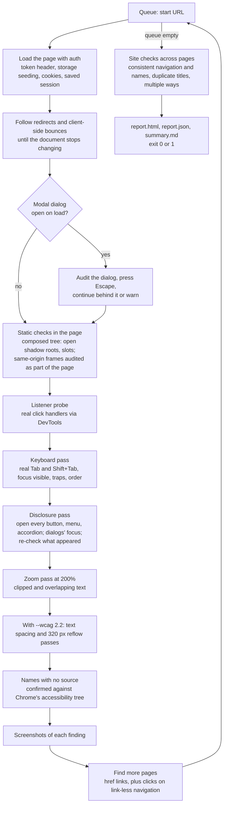
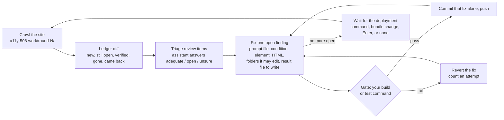
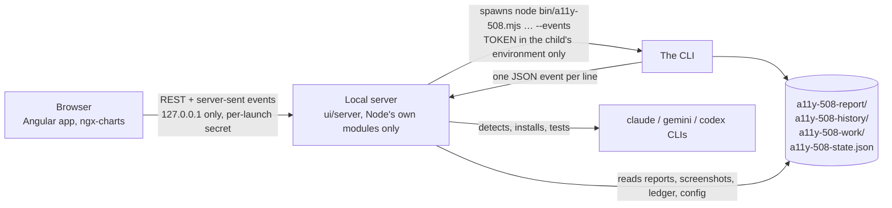

# a11y-508

A Section 508 crawler with **no dependencies**. It drives the Chrome, Chromium, or Edge already installed on the machine over the DevTools Protocol, crawls every same-origin page it can reach, runs the automatable [DHS Trusted Tester v5](https://section508coordinators.github.io/TrustedTester/) test conditions on each page, and writes a report that separates:

- **Violations**: determinate failures of a Trusted Tester test condition.
- **Review items**: escalations for a human. The tool found something it cannot judge (an alt text, a link name, a form's error handling) and says exactly what to check, with the element, its HTML, and a screenshot.
- **Manual checklist**: the test conditions that can only be performed by a person.

It exists for environments where nothing can be published to a package registry and nothing can be downloaded at install time. It is plain JavaScript; nothing is fetched from the network except the site being audited. There are two ways to use it:

- **The dashboard**, for developers: clone this repository once, run `npm run ui`, point it at any repository on your machine, and sign in, crawl, read the report and run the fix loop from screens instead of a terminal.
- **The command line**, for CI and for AI coding assistants: one command, exit code 1 when violations exist, a report as a build artifact.

Both do the same work; the dashboard drives the command line underneath.

**AI coding assistants:** if you were told to read this file and get the crawl working, follow the [runbook](#runbook-for-ai-coding-assistants) below. It tells you which command to run next for every outcome.

```bash
TOKEN=eyJhbGciOi... npm run e2e:a11y-508 https://app.example.gov
```

## Contents

- [How to use it](#how-to-use-it): [requirements](#requirements), [the dashboard](#the-dashboard), [the command line](#the-command-line), [the fix loop](#the-fix-loop), [in CI and other repositories](#in-ci-and-other-repositories)
- [How it works](#how-it-works): [the crawl](#the-crawl), [the fix loop's cycle](#the-fix-loops-cycle), [the dashboard's parts](#the-dashboards-parts), [authentication](#authentication), [coverage](#coverage-pages-without-links), [the event stream](#the-event-stream---events)
- [What it checks](#what-it-checks), [Beyond Section 508](#beyond-section-508), [Reading the report](#reading-the-report), [What this cannot do](#what-this-cannot-do)
- [Runbook for AI coding assistants](#runbook-for-ai-coding-assistants)
- [Development](#development)

## How to use it

### Requirements

- Node.js 18 or newer.
- Chrome, Chromium, or Microsoft Edge installed. Auto-detected on macOS, Linux, and Windows, or set `CHROME_PATH`.

That is all. There is no `npm install` step, for the command line or the dashboard.

### The dashboard

A local web dashboard does everything the command line does, as screens instead of a scrolling log: sign in, start a crawl and watch it page by page, troubleshoot, read the report with charts and filters, and run the fix loop with an assistant picker and a ledger board. It is built on the CLI, which still does the work, and it runs only on your machine, for you.

```sh
git clone https://github.com/AiFirstDevelopment/a11y-508.git
cd a11y-508
npm run ui                                # opens http://127.0.0.1:5508/#secret=...
node ui/server/main.mjs --dir ../my-app   # the same, started in another repository
```

Then, in the browser, a wizard across the top: **1 Set up → 2 Crawl → 3 Results → 4 Fix → 5 History**. Only the step in hand is on screen, steps that make no sense yet are not reachable (Results, Fix and History while a crawl runs; Fix outside a repository), and each step ends with its one forward action. Every step shows counts, not details; a small **Details** link at the bottom opens the full view (charts, tables, the command line, raw output), and stays open once opened.

1. **Set up.** The app's repository folder (paste a path, or **Browse…**) and its URL, then **Start**. On a first visit this is a dialog; afterwards the folder is remembered in your browser and the dashboard opens on it. The header's **Change…** switches folders at any time. A crawl needs neither git nor a package.json; the fix loop needs the app's repository.
2. **Crawl.** Start opens a fresh Chrome window on the URL; you sign in there (through the single sign-on portal if the app uses one) and the crawl runs in that window (`--login --stay`). The step shows one status line ("Waiting for you to sign in in the browser window · 48 s", "Analyzing /layout/default · 1,240 elements", "Taking screenshots · 9 of 22"), the pages done, the violations and review items so far, the elapsed time, and **Stop**. When it is done the wizard moves to Results by itself. A crawl that could not get in stays here with a notice and **Troubleshoot**.
3. **Results.** The result line, then the audited routes, worst first, each with its counts; choosing one lists its findings (a badge, the test, the message, **Details** for the selector, HTML and screenshot). Totals, charts and the manual checklist are under Details. **Fix the violations** goes on to Fix and starts it.
4. **Fix.** "Fixing with Claude Code (version)" (*change* opens the picker), one line of what it will do ("Edits `src` · gate `npm run build` · commits to branch `a11y-508` · pushes to `origin`"), and while it runs: the round and the fix in hand with its time, a bar of fixes, "5 fixed · 2 remaining · 1 needs a person", and the assistant's last line of output (**Show output** opens the whole of it). When the loop ends: **See what changed** and **Run again** (a new crawl from the same set up, then Results and Fix, with the ledger carried forward).
5. **History.** The crawls and the fix rounds in one timeline (found, fixed, remaining, commits), and **Run again**.

Settings beyond these (a token or cookies instead of signing in, page limits, include and exclude patterns, every crawl flag, the loop's settings) are at `/run/advanced` and `/fix-loop/settings`; nothing links to them.

#### The dashboard runs in its own browser window

`npm run ui` opens the dashboard in a Chrome window of its own, with a persistent profile at `~/.a11y-508/browser-profile` (`%APPDATA%\a11y-508\browser-profile` on Windows) and a DevTools port. Every crawl's sign-in and pages are tabs in that same window (the CLI's `--connect <port>`): Start opens a tab, you sign in there if the portal asks ("Sign in in the tab that just opened · 12 s"), the crawl continues in that tab, one page at a time, and the tab closes when it is done, leaving the dashboard's. Because the profile persists, the portal's sign-in is usually remembered from one launch to the next, and the tab goes straight to the app. Closing that window ends the dashboard; Ctrl+C in the terminal closes the window. The fix loop's first round signs in the same way; its later rounds crawl headless with the saved session. Without Chrome (or with `A11Y_508_OWN_BROWSER=0`, or `--no-open`), your usual browser opens the address and the sign-in opens a separate window.

#### Where the dashboard keeps its files

The dashboard writes nothing of its own into the app's repository. Its loop config (`config.json`), the sign-in session (`state.json`) and your remembered choices (`settings.json`) are kept per working directory in `~/.a11y-508/<12 hex of the directory's path>/` (`%APPDATA%\a11y-508\…` on Windows), and the dashboard passes `--config` and `--state` with those paths. If the repository has its own `a11y-508.config.json` (a team's, for CI), the dashboard uses it as is and never writes to it. The outputs, `a11y-508-report/`, `a11y-508-history/` and `a11y-508-work/`, stay in the working directory, where the CLI and the runbook expect them, and the dashboard adds them to the repository's `.git/info/exclude` (local to your clone, never committed). Files an earlier version left in the repository are moved out after you confirm. The CLI run by hand keeps its defaults (`a11y-508-state.json`, `a11y-508.config.json` in the current directory).

Nothing has to be installed: the server uses only Node's own modules, and the built app is committed under `ui/dist/`. It listens on `127.0.0.1` only (port 5508, or the next free one; `--port <n>` to choose) and opens your browser; `--no-open` prints the address instead.

- **The address carries a secret.** Each launch makes a random secret and puts it in the address it opens. The app keeps it for the tab and sends it on every request; anything without it gets 401, and a request for any host other than `127.0.0.1:<port>` or `localhost:<port>` gets 403. The folder picker is behind the same secret and lists folder names only, never files; the recent folders are kept in your browser.
- **The token stays in memory.** It is passed to the CLI in its environment only, never written to disk, never sent back to the browser, and blanked out of the CLI's output if it ever appears there.
- **Reports are kept.** Before each crawl the previous `a11y-508-report/` moves to `a11y-508-history/<finished-at>/`, so the latest report stays where the runbook says and History lists the earlier ones. **Clear history** (after a confirmation) and each row's **Delete** remove them; the latest report and the loop's rounds are never removed that way. Add `a11y-508-history/` to `.gitignore`.
- **The fix loop's assistant** is found on `PATH`, through your login shell, or in `npm prefix -g`'s bin folder. *Test assistant* calls it once, to show it is installed and signed in before a loop spends a round finding out. On Windows, "your shell" is Git Bash, which comes with Git for Windows (the loop needs git anyway); without it the dashboard falls back to PowerShell or cmd.
- **Beyond Section 508.** *Also check WCAG 2.2 (beyond Section 508)* under **Advanced** adds `--wcag 2.2` to the run (see [Beyond Section 508](#beyond-section-508)); the Report screen then lists those rules under their own heading and in their own group of the test filter.
- **Every chart has a data table** with the same numbers, and chart animations are off when you have asked your system for reduced motion.

In a repository that vendors the tool (see [In CI and other repositories](#in-ci-and-other-repositories)), add a script next to the existing one:

```json
"e2e:a11y-508:ui": "node tools/a11y-508/ui/server/main.mjs"
```

### The command line

```sh
TOKEN=... node bin/a11y-508.mjs https://app.example.gov --max-pages 50
```

The crawl prints each page as it finishes, then a summary, the report paths, the coverage warnings, and `PASS` or `FAIL`. Exit codes: `0` no violations at the `--fail-on` impacts, `1` violations found, `2` usage or crawl error, `3` the browser could not start.

```
a11y-508 <url> [options]

  --max-pages <n>          Maximum pages to audit (default 200)
  --max-depth <n>          Maximum link depth from the start URL (default 10)
  --concurrency <n>        Parallel tabs (default 4)
  --include <regex>        Only audit URLs matching this pattern (repeatable)
  --exclude <regex>        Skip URLs matching this pattern (repeatable)
  --fail-on <list>         Impacts that fail the run: critical,serious,moderate,minor
                           or "none" (default critical,serious)
  --out <dir>              Report directory (default ./a11y-508-report)
  --viewport <WxH>         Viewport size (default 1280x800)
  --timeout <ms>           Page load timeout (default 30000)
  --settle <ms>            Extra wait after load for scripts to render (default 500)
  --header "Name: value"   Extra request header, sent to every request (repeatable)
  --token-header <name>    Header that carries TOKEN (default Authorization)
  --auth-origin <origin>   Additional origin that also receives TOKEN (repeatable)
  --token-storage <key>    Also seed TOKEN into web storage under <key> (repeatable)
  --no-token-storage       Do not seed TOKEN into localStorage/sessionStorage
  --cookie "name=value"    Cookie set on the start origin before the crawl (repeatable)
  --login                  Open a visible browser to sign in once (works with external
                           SSO portals), save the session to --state, then crawl with it
  --state <file>           Session file to crawl with, or to write when used with --login
                           (default with --login: a11y-508-state.json)
  --login-only             Sign in and save the session file, then exit without crawling
  --stay                   With --login: keep the signed-in window and crawl in it (one
                           tab), so whatever the sign-in set up is used as it is
  --connect <port|ws://…>  Use a browser that is already running (started with
                           --remote-debugging-port): tabs open in its window, one at a
                           time, and are closed at the end; the browser stays open.
                           With --login the sign-in tab is where the crawl continues
  --troubleshoot           Load only the start URL with the configured auth and explain
                           what happened (redirects, storage keys the app read, cookies,
                           whether the header went out) with the next step to take
  --no-interact            Skip the keyboard and disclosure-activation passes
  --no-zoom                Skip the 200% zoom pass
  --wcag <version>         2.0 (default): the Trusted Tester checks only, as Section 508
                           requires. 2.1 or 2.2 also runs the WCAG 2.1/2.2 rules and best
                           practices beyond Section 508, listed under their own heading
  --beyond-508             Same as --wcag 2.2
  --no-screenshots         Do not capture element screenshots
  --max-screenshots <n>    Screenshots per page (default 40)
  --max-tabs <n>           Maximum Tab presses per page (default 400)
  --max-activations <n>    Disclosure controls activated per page (default 12)
  --max-clicks <n>         Link-less navigation controls clicked per page to find pages
                           reachable only through click handlers (default 30)
  --no-follow-clicks       Do not click controls to discover pages; follow href links only
  --user-agent <ua>        Override the browser user agent
  --chrome <path>          Browser executable (default: auto-detect, or CHROME_PATH)
  --no-sandbox             Pass --no-sandbox to Chrome (containers running as root)
  --quiet                  Only print the summary
  --json                   Print the report summary as JSON on stdout
  --events                 Print one JSON event per line on stdout instead of the
                           human-readable output (for tools; see the README)
  --list-tests             Print the Trusted Tester test catalog and exit (with --wcag
                           2.1/2.2, also the rules beyond Section 508)
```

The loop has its own commands:

```sh
TOKEN=... a11y-508 loop                 # or: npm run e2e:a11y-508 loop
a11y-508 loop --dry-run                  # crawl and update the ledger, nothing else
a11y-508 loop --max-rounds 1 --agent gemini
a11y-508 status                          # what is open, pending, verified, needs a person
```

### The fix loop

`a11y-508 loop` turns the crawl into an unattended fix cycle driven by an AI coding assistant of your choice. Each round it crawls, diffs the findings against the last round, has the assistant judge the review items and fix the open violations one at a time, gates every fix with your own build or test command, commits and pushes what survives, waits for the deployment, and crawls again. It keeps going until nothing is open or you press Ctrl+C, and a stopped loop resumes where it was because all state is in `a11y-508-work/ledger.json`. [How the cycle works](#the-fix-loops-cycle) is drawn below.

`--from-report <report.json>` starts round 1 from a report you already have instead of crawling again: the report is folded into the ledger as a crawl's would be (the round is recorded with `"source": "report"`), triaged and fixed, and the first crawl is round 2's, after the fixes are committed and deployed, to verify them. The report must be for the config's URL (origin and path) and newer than the loop's last commit; otherwise the loop says why and crawls as before. The dashboard's **Fix the violations** passes the latest report when it is for the loop's URL, so the Fix step starts with "Round 1: fixing 3 of 14 from the report you just saw".

Nobody reviews the assistant's changes before they are committed; the gate command stands in for the reviewer, and each fix is its own commit so a bad one can be reverted by hand later.

For an app behind a sign-in portal, when the repository holds a saved session (`a11y-508-state.json`, or the file named by the config's `state`) and the crawl options name no other way in (`--state`, `--login`, `--cookie`), every round's crawl uses it, and the loop says so once ("crawling with the saved session a11y-508-state.json").

In the dashboard the Fix loop screen infers the settings instead of asking: the installed assistant (Claude Code before Gemini CLI before Codex), the folders to edit (`src`, `app`, `lib` or `projects`, else the folders holding `.ts`, `.js` or `.html` files), the gate (`npm run build && npm test` from the package's scripts, leaving out npm's placeholder `test`), the branch `a11y-508`, pushing when the repository has an `origin`, three attempts per finding, and watching the start page for the new build (deployment happens outside the tool; **Deployed — continue** moves on at once). It says it in one line ("Edits `src` · gate `npm run build` · commits to branch `a11y-508` · pushes to `origin`"), and **Fix the violations** writes `a11y-508.config.json` from those values if there is none and starts the loop; an existing config wins over every inference. Every setting is editable at `/fix-loop/settings` (nothing links to it), which saves as you change it and also holds a dry run (*Record findings without fixing*). While the assistant works, its output streams into a pane with a running timer, and the command to run it by hand, for your shell, is shown with a Copy button.

Put `a11y-508.config.json` in the repository to fix (the dashboard's Fix loop screen writes the same file):

```json
{
  "url": "https://app-dev.example.gov/layout",
  "args": ["--max-pages", "50"],
  "agent": "claude",
  "source": ["src"],
  "check": "npm run build && npm test",
  "branch": "a11y-508/fixes",
  "deployed": "bundle-change"
}
```

| Key | Meaning |
|---|---|
| `url` | Start URL. The command line overrides it. |
| `args` | Crawl options used in every round, same as the basic run. Options on the `loop` command line are added. |
| `agent` | `claude`, `gemini`, `codex`, or any command. The presets run the assistant in non-interactive mode with file edits allowed. A custom command gets the prompt's path as `{promptFile}` and may also use `{resultFile}`. |
| `source` | Folders the assistant may edit (default `["src"]`). Changes anywhere else are reverted. |
| `check` | Build and test command run after each fix. A non-zero exit reverts the fix. `"checkEvery": "round"` runs it once per round instead and rolls back the whole round on failure. No `check` means no gate, with a warning. |
| `branch` | Branch to commit on (created if missing). Default: the current branch. `"push": false` keeps commits local. |
| `deployed` | How the loop knows the new build is live: `"command"` runs `deploy` and continues when it exits; `"bundle-change"` polls the start page every 15 seconds until its script and stylesheet URLs change (the default `deployTimeout` is 30 minutes); `"enter"` prints a prompt and waits for Enter; `"none"` continues at once (only for sites served straight from the working tree). Default: `"command"` if `deploy` is set, else `"enter"`. |
| `maxAttempts` | Fix attempts per finding before it is marked needs-human (default 3). |

What the assistant gets: one prompt per task, written to a file under `a11y-508-work/`, with the finding's test condition, message, pages, selector and rendered HTML, the folders it may edit, the folders it must not touch, and the path of the JSON result file it has to write. It never sees the token, the session file, or the report as a whole, and the token is stripped from its environment. A finding that is still present after `maxAttempts` fixes, or whose fix fails the gate that many times, is marked needs-human and dropped from the loop so one stubborn issue cannot keep it running. Review items the assistant calls "unsure" go to needs-human as well.

The loop refuses to start on a repository with uncommitted changes under `source`, so its commits only ever contain its own work. Each round's crawl output is kept in `a11y-508-work/round-N/`; add `a11y-508-work/` to `.gitignore`.

Each assistant call leaves `a11y-508-work/agent-r<round>-<task>.log` beside its prompt and result: a header line (exit code, time-out, quota) and the tail of its output. A call that writes no result and whose output names a quota or rate limit (HTTP 429, `RESOURCE_EXHAUSTED`, "quota", "rate limit") is run again after 30 seconds and then 90 seconds before it counts as a failed attempt; free tiers limit requests per minute. With `"agent": "gemini"` the loop sets `GEMINI_CLI_TRUST_WORKSPACE=true` for the assistant (Gemini CLI will not run headless in a folder it has not been told to trust) and hands it the prompt on stdin, because Gemini CLI's file reader refuses files that `.gitignore` lists, `a11y-508-work/` among them.

### In CI and other repositories

The command line is what CI runs. Copy the tool into the consuming repository and add one script. `git subtree` keeps a record of where it came from so it can be updated later; a plain copy of the folder works too.

```bash
git subtree add --prefix tools/a11y-508 https://github.com/AiFirstDevelopment/a11y-508.git main --squash
```

In the consuming repository's `package.json`:

```json
{
  "scripts": {
    "e2e:a11y-508": "node tools/a11y-508/bin/a11y-508.mjs"
  }
}
```

Add `a11y-508-report/` to `.gitignore`. Then:

```bash
TOKEN=<token> npm run e2e:a11y-508 https://staging.example.gov
```

npm passes the URL through to the script. Options that start with `--` need the usual npm separator: `npm run e2e:a11y-508 https://site -- --max-pages 50`.

To update later:

```bash
git subtree pull --prefix tools/a11y-508 https://github.com/AiFirstDevelopment/a11y-508.git main --squash
```

If GitHub is not reachable from the environment, mirror this repository to the internal git host and use that URL instead.

#### Prompt for an AI coding assistant

Paste this into Claude Code, Copilot, Cursor, or similar when working in the repository that should get the check:

> Add the a11y-508 Section 508 crawler to this repository so that `npm run e2e:a11y-508 <url>` works.
>
> 1. Vendor the tool with `git subtree add --prefix tools/a11y-508 https://github.com/AiFirstDevelopment/a11y-508.git main --squash`. If subtree or network access is unavailable, copy the `bin/` and `src/` directories plus `README.md` and `LICENSE` from that repository into `tools/a11y-508/`. Do not add it as an npm dependency and do not run `npm install` for it; it has no dependencies.
> 2. Add the script `"e2e:a11y-508": "node tools/a11y-508/bin/a11y-508.mjs"` to `package.json`. If this repository already has an `e2e:` script naming convention, keep this name anyway; it is what the team's CI expects.
> 3. Add `a11y-508-report/` to `.gitignore`.
> 4. The tool reads the environment variable `TOKEN` and sends it as `Authorization: Bearer <TOKEN>` on same-origin requests only. Do not hard-code a token anywhere. If this project's local dev server needs a different header name, use `--token-header <name>`.
> 5. Verify by running `npm run e2e:a11y-508 http://localhost:<port>` against the running dev server (set `TOKEN` if the server requires it) and confirm `a11y-508-report/report.html` is produced. The command exits 1 when critical or serious violations exist, which is expected on a first run; do not change `--fail-on` to make it pass.
> 6. Optionally add a CI job that runs the same command against the deployed preview/staging URL with `TOKEN` supplied from the CI secret store, and publishes `a11y-508-report/` as a build artifact.
>
> The tool needs Node 18+ and a Chrome, Chromium, or Edge binary on the machine (`CHROME_PATH` if it is not in a standard location). It does not download a browser.

#### The loop, end to end in CI

`.github/workflows/loop-gemini.yml` proves the whole product on Windows: it crawls a small app with planted Section 508 violations, lets the loop repair them with Gemini CLI's free tier (`gemini-flash-lite-latest` by default, through `GEMINI_MODEL`; `gemini-2.5-flash` is no longer offered to new keys, `gemini-3.8-flash`'s free daily quota runs out after a few calls, and a manual run can choose another model), and confirms the repairs with the next crawl. The app is `test/loop-app/`: four pages (a home page with images, a contact form, an opening-hours table, a gallery with a modal viewer) and a stylesheet, with about ten violations marked by HTML comments (missing alt, an unlabelled field, low-contrast CSS, a page without `lang`, the same link text for two destinations, a page with no skip link, main or heading, a fieldset without a legend, an icon-only button, `scope="column"`, `aria-labeledby`). Before the loop, one direct `gemini -p` call with a 90-second limit shows whether Gemini answers at all: a quota refusal there makes the run SKIPPED, anything else fails it at once. The loop's config gives each assistant call three minutes and triages in batches of eight; `a11y-508-work/agent-calls.log` has a line when each call starts and ends. The job makes a throwaway git repository holding the app, runs `a11y-508 loop --max-rounds 2` against it with the gate `node check.mjs` (every page still parses and is still served), then `a11y-508 status`, and `test/loop-app/verify.mjs` asserts that round 1 recorded at least ten findings, that round 2 verified at least one fix, that the loop committed, that no commit touched anything outside `site/`, and that the gate ran for every fix. It does not assert how many fixes the model makes. A run in which every assistant call was refused for quota is reported as SKIPPED, not failed. The work directory (ledger, prompts, results, agent logs, round reports, the git log) is uploaded as the `loop-gemini-work` artifact.

It needs the repository secret `GEMINI_API_KEY`, a Google AI Studio key (the free tier is enough); without it the job says so and stops green. It runs on pull requests that change `src/loop.mjs`, `src/agent.mjs`, `src/ledger.mjs`, `test/loop-app/` or the workflow, and by hand (`gh workflow run loop-gemini.yml --ref <branch>`); it is not a required check.

To run the same thing by hand, with Gemini CLI or Claude Code installed and signed in:

```sh
node test/loop-app/setup.mjs ../loop-test --agent gemini     # or --agent claude
cd ../loop-test
node server.mjs > ../server.log &                             # http://127.0.0.1:4321/; logs outside the repository,
                                                              # or the loop reverts them as stray changes
GEMINI_MODEL=gemini-flash-lite-latest node ../a11y-508/bin/a11y-508.mjs loop --max-rounds 2
node ../a11y-508/bin/a11y-508.mjs status
node ../a11y-508/test/loop-app/verify.mjs .
```

## How it works

### The crawl

One Chrome, started headless with a temporary profile, with up to `--concurrency` tabs, each in its own window. Each tab takes the next URL from the queue, audits it, and feeds the links it found back into the queue, until the queue is empty or `--max-pages` is reached.



The in-page checks are one JavaScript bundle (`src/checks/browser/*.js`) evaluated in each page; the interactive passes (`src/passes.mjs`) drive the page over the DevTools Protocol and re-run the bundle on what they reveal. Every finding carries the Trusted Tester test, the WCAG criterion, the element's selector and HTML, a message that says what to fix, and, where it matters, the data behind the decision (a contrast ratio and the colours, a heading outline, the name that was computed).

### The fix loop's cycle



Statuses in `a11y-508-work/ledger.json`: `review` (awaiting triage), `adequate` (triage closed it), `open` (to be fixed), `pending` (fixed, waiting for the next crawl to confirm), `verified` (confirmed gone after a fix), `gone` (disappeared without a fix), `needs-human` (the loop gave up: `maxAttempts` reached, the gate kept failing, or triage said unsure), `wont-fix` (set by a person). `a11y-508 status` prints them.

### The dashboard's parts



The server holds one run at a time and relays the CLI's [event stream](#the-event-stream---events) to the browser, which draws the progress bar, the page list and the ledger board from it. Stopping a run signals the CLI, which closes its browser; on Windows the whole process tree is ended.

### Authentication

`TOKEN` is sent as `Authorization: Bearer <TOKEN>`. If the value already starts with a scheme (`Bearer x`, `Basic x`, `Token x`) it is sent unchanged. The header goes only to the start URL's origin, plus any `--auth-origin`, so a token is never leaked to third-party assets. If the site turns the token into a session cookie on the first request, that cookie is kept for the rest of the crawl.

Most single-page apps never look at the request header: their auth guard reads the token from `localStorage` or `sessionStorage` and redirects to the login page when it is missing. So when `TOKEN` is set the crawler also writes the raw token (scheme stripped) into both storages before any page script runs, on the same origins, under the keys apps most often use: `token`, `access_token`, `accessToken`, `id_token`, `idToken`, `jwt`, `auth_token`, `authToken`. Add the key your app reads with `--token-storage <key>` (repeatable) if it is not in that list; `--no-token-storage` turns the seeding off. A value the app writes itself, such as a refreshed token, is never overwritten.

If the app relies on a session cookie instead, set it with `--cookie "name=value"` (repeatable), for example `--cookie "session=$SESSION"`. Cookies are set on the start origin and any `--auth-origin` before the first navigation. Note that browsers scope cookies by host, not port, so on `localhost` a cookie is visible to every port.

#### Sign-in portals and single sign-on

When the app sends the browser to a login page on another domain (an SSO portal, an OpenID Connect provider, a company identity service), no token or cookie you can guess will get past it, and the crawl stops with `redirected off-origin to ...` on the start page. Sign in once interactively instead:

```sh
a11y-508 https://app.example.gov --login
```

A browser window opens on the start URL. Sign in there. Once the app itself has loaded and stayed put for six seconds the crawler carries on by itself (in an interactive terminal you can also press Enter): it captures the cookies and web storage the sign-in left behind, writes them to `a11y-508-state.json`, closes that window, and runs the normal headless crawl with that session. Cookies are kept for the app's origins and for the portal hosts the sign-in bounced through, because apps that re-check the SSO session on every page load need both. Reuse the file on later runs until the session expires:

```sh
a11y-508 https://app.example.gov --state a11y-508-state.json
```

`--login --stay` keeps the window and crawls in it: the session file is still saved, but the crawl runs in the same visible browser, one tab at a time (`--concurrency` is 1; a visible browser paints only its front tab), so cookies, storage and service workers the sign-in set up are used as they are, and `report.json` records `options.stay: true`. The dashboard's **Sign in** runs this. `--stay` without `--login` is a usage error.

`--login-only` signs in, saves the file, and exits without crawling, which keeps the interactive step short when a coding agent or a script drives the tool.

The file holds live credentials, including the portal's session cookie. It is written with owner-only permissions and `a11y-508-state.json` is in this repository's `.gitignore`; keep it out of version control. `--login --state <file>` chooses where to write it. For CI, sign in on a workstation and provide the file from the secret store.

During the crawl, a page that bounces through the portal and back (or any script-driven redirect) is followed until the document stops changing, and the page that finally lands is the one audited. A run in which no page could be audited is reported as FAIL, never PASS.

#### When the crawl cannot get in

`--troubleshoot` loads only the start URL, with whatever auth is configured (`TOKEN`, `--cookie`, `--state`), and explains what happened instead of auditing:

```sh
TOKEN=... a11y-508 https://app.example.gov/layout --troubleshoot
```

It prints the navigation chain hop by hop (HTTP redirects and script-driven navigations, with status codes), whether the auth header actually went out on the page request, which web storage keys and cookies the app's own scripts read or wrote before it left (keys only, never values), what is in storage and the cookie jar afterwards, and a verdict with the next step: add `--token-storage <key>` when the app reads a key the tool did not seed, or `--login-only` when the server or the app insists on a real session. Exit code 0 means the page landed on the app and the crawl should work. `--json` prints the same as JSON.

#### Flaky networks and Windows

Navigation errors that are usually momentary (`net::ERR_SOCKET_NOT_CONNECTED`, `ERR_CONNECTION_RESET`, `ERR_EMPTY_RESPONSE`, `ERR_NETWORK_CHANGED`, and similar) are retried up to three times with backoff before a page is recorded as failed; pages that needed a retry carry `navRetries` in the report. On Windows, Chrome can keep its temporary profile open for a moment after it closes; the crawler waits for the browser to exit, retries the cleanup, and prints the directory to delete by hand if it still cannot remove it, without failing the run. A browser that does not answer within 30 seconds of starting is killed and started once more with a fresh profile before the run gives up (exit 3); when that happened, the output says so and `report.json`'s `browser` field is `{ name, launchRetries: 1 }` instead of the plain name.

The crawl stays on the start URL's origin, ignores binary links (PDF, images, archives), closes any pop-up windows, and refuses downloads.

### Coverage: pages without links

The crawler finds pages by following `href` links. Many single-page apps navigate from buttons, menu items or `routerLink` elements that have no `href`, and a crawler that only reads links would audit the first page and stop, which looks like a complete run. To avoid that, after auditing a page the crawler clicks up to `--max-clicks` controls that look like navigation but have no link: elements with a router or `data-href` attribute, `role="link"`, `menuitem`, `tab` or `treeitem`, links whose `href` is `javascript:` or a bare `#` (a click handler dressed as a link), and pointer-cursor items or buttons inside navigation, menus, headers and sidebars. Any same-origin URL a click leads to, including `pushState` routes and `#/` hash routes, is queued and audited, and is marked `foundBy: "click"` in the report. Controls whose name looks like an action (Save, Delete, Submit, Sign out, Approve, Export and similar) and anything inside a form or dialog are never clicked. `--no-follow-clicks` turns this off.

Search screens show their results only for a query, so after a page's checks and before route discovery the crawler fills and submits up to three forms per page that look like searches or filters: a form, a `role="search"` region, or a group of fields with a button, whose button reads like Search, Filter, Apply, Go, Find or Refresh, and which is not in a dialog. Date fields (`type="date"`, or text fields labelled from/to, start/end or date, in pairs) get the last `--search-months` months (default 3): from that many months ago to today, in the format the field expects (ISO for `type="date"`, the placeholder's pattern such as MM/DD/YYYY for text), set the way typing sets them so Angular and React see the change; a preset at least that wide ("Last 6 months") is chosen instead when there is one. Free-text search fields stay empty unless required. It then waits for the page to settle, re-checks the result area (those findings are labelled `after searching the last 3 months`; the page's own audit is its state before the search), and queues what the results lead to: their links, result rows and View or Details controls clicked within `--max-clicks`, pagination, and the result page of a form that navigates. These pages are marked `foundBy: "form"`, and the first two results of each search are audited even when they are query variants of an audited route. A form with a button named like an action (Save, Submit alone, Create, Delete, Send, Pay and similar) is never submitted. The page records `discovery.forms = { filled, submitted, results }`, the Live screen shows "Searching the last 3 months · 2 forms", the Found column reads "2 links · 5 clicked → 3 new · 1 search → 8 results", and the coverage section notes a search that returned nothing even for the whole range. `--no-forms` turns this off.

Links that differ from an audited page only in their query values (`/search?from=1&to=2` after `/search?from=3&to=4`: one route, different parameters) are audited at most twice per route, so an app whose pages link to date or filter variants of themselves is not crawled to the page limit; the coverage section notes how many such links were left out. A different set of parameter names is a different route.

Every report has a coverage section. It warns when only the start page could be audited, when controls were skipped because they look like actions, when `--max-clicks` or `--max-pages` cut the crawl short, when a modal dialog open on load could not be dismissed (see below), when a page the server answered 404 for rendered content and was audited anyway (single-page apps often serve the app with a 404 status for a deep link; the page result records `servedWith: 404`), and notes pages that were reachable only by clicking (keyboard and screen reader users cannot discover those as links), components with a closed shadow root, frames from other origins and frames nested too deep to audit (see [Shadow DOM and frames](#shadow-dom-and-frames)). A run that passes on violations but has coverage warnings prints `PASS on the N page(s) audited, but COVERAGE IS INCOMPLETE` rather than a plain PASS.

#### Modal dialogs open on load

A page that opens a modal dialog as it loads (a cookie or consent banner shown with `showModal()`, or a visible `role="dialog"` with `aria-modal="true"`) hides everything else from assistive technology, and so from the checks. The crawler audits the dialog, runs the keyboard pass inside it (its own controls get the focus-visible checks; a modal that keeps focus is not called a keyboard trap, since Escape is its way out; `passes.keyboardModal`), presses Escape once, and if the dialog closed, audits the page behind it; those findings are labelled `after closing the modal shown on load`. The page result records `modalOnLoad: { selector, name, dismissed }`. A pass that reloads the page (the disclosure pass after a control navigates, and route discovery) brings the dialog back, so it presses Escape again and counts it in `modalOnLoad.redismissed`. When Escape does not close it, the page behind it was not audited: the coverage section warns, naming the dialog, and `summary.modalsNotDismissed` counts such pages. Dismiss it with `--cookie` or a saved session (`--login`, `--state`), or audit its close control by hand. The keyboard and disclosure passes run on whatever state the page is in afterwards.

### The event stream (--events)

With `--events` the CLI prints one JSON object per line on stdout instead of its human-readable output, for tools such as the dashboard. It takes precedence over `--json` and `--quiet`; without it, the output is unchanged. Every event has `type` and `at` (an ISO timestamp); the last line is `done`, unless the process was interrupted (Ctrl+C or SIGTERM), in which case it exits with code 130 and prints no `done`.

| type | fields | when |
|---|---|---|
| `start` | `kind` (`crawl`, `troubleshoot`, `login`, `loop`), `version`, `url`, `maxPages` | first |
| `info`, `warn`, `error` | `message` | a line the human output would print, by level |
| `page` | `url`, `finalUrl`, `title`, `status`, `error`, `skipped`, `violations`, `reviews`, `byImpact`, `durationMs`, `foundBy`, `modalOnLoad` (or `null`), `servedWith` (404 when the server said not found and the app rendered the page anyway, else `null`), `links` (links found on the page), `clicked` (controls clicked by click discovery; `null` when it did not run), `clickedNew` (new URLs those clicks led to; `null` likewise), `skippedActions` (names of controls not clicked because they look like actions, up to 20), `skippedActionsCount`, `done` (pages finished so far), `discovered` (pages found so far), `limit` (`--max-pages`) | each page as it finishes; `done` over `discovered` is the progress |
| `progress` | `url`, `phase` (`loading`, `checks`, `keyboard`, `disclosures`, `frames`, `zoom`, `names`, `screenshots`, `discovery`), `detail` (the phase's count: `elements`; `stops`/`of`; `done`/`of`; `checked`/`of`; `clicked`/`of`; or `null`), `elapsedMs` | where a page in flight is: at each phase and at least every 2 seconds within one, at most about five a second |
| `coverage` | `complete`, `warnings`, `notes` | after the crawl |
| `summary` | `result` (`pass`, `fail`, `incomplete`, `nothing-audited`), `passed`, `baseUrl`, `failOn`, `summary` (as in `report.json`), `files` | after the crawl |
| `troubleshoot` | `result` (the `--troubleshoot --json` object) | `--troubleshoot` |
| `login-waiting` | `url`, `stableSeconds` | `--login`: the sign-in window is open |
| `session-saved` | `file`, `summary` | `--login`: the session file was written |
| `round` | `round` | loop: a round starts |
| `step` | `round`, `step` (`crawl`, `triage`, `fix`, `gate`, `commit`, `push`, `deploy`, `await-deploy`), and `count` or `n`/`m` where they apply | loop: what it is doing now |
| `task` | `round`, `n`, `m`, `test`, `impact`, `message`, `state` (`start`, `done`), `outcome` (`committed`, `no-change`, `failed-gate`, `commit-failed`) | loop: fix *n* of *m* |
| `ledger` | `rounds`, `counts` (by status), `line` | loop: whenever the ledger changes |
| `await-deploy` | `round`, `committed`, `nextRound` | loop with `"deployed": "enter"`, or `"bundle-change"` under `--events`: write a newline to stdin to continue |
| `agent-output` | `round`, `task`, `kind` (`fix`, `triage`), `stream` (`stdout`, `stderr`), `text` | loop: the assistant's output as it arrives, a few events a second at most per call |
| `done` | `code` (the exit code) | last |

In a loop, each round's crawl runs with `--events` too, and its `page`, `coverage` and `summary` events are passed on with a `round` field, so a round shows the same per-page progress as a plain crawl.

## What it checks

Every finding carries a Trusted Tester test ID and the WCAG success criterion. `--list-tests` prints the catalog.

| TT test | Condition | Automation |
|---|---|---|
| 1.A–1.E | Conforming alternate version | manual |
| 2.A | Audio control | autoplay with sound and no controls is a violation, unless it lasts 3 seconds or less without `loop` (escalated); embedded players are escalated |
| 2.B | Moving, blinking, scrolling | `marquee`/`blink` are violations; infinite CSS animations, autoplaying video, carousels are escalated |
| 2.C | Auto-updating | `meta refresh` reload is a violation |
| 2.D | Change notification (auto) | manual |
| 3.A | Flashing | fast infinite animations are escalated |
| 4.A | Keyboard access | widget roles and click handlers on non-focusable elements (found through DevTools event-listener inspection), `aria-hidden` focusables (content that is `inert`, in a disabled fieldset, or outside an open modal dialog is not focusable), custom controls that ignore Enter/Space; `aria-activedescendant` on a host that cannot take focus, or pointing at an id that does not exist, at an element outside the host (or what it owns or controls), or at one with no widget role; a page hidden from assistive technology (`<body aria-hidden="true">`, or an `aria-hidden`/`inert` element holding 80% or more of the visible text while no modal dialog is open) is critical, since every other test is silenced; server-side image maps (`img[ismap]`); an `iframe` with `tabindex="-1"` whose same-origin document has tabbable content (frames under 30×15 px, behind an open modal, or cross-origin are skipped); scrolling regions with content outside their box and nothing focusable in them, escalated (Chrome 130+ makes them focusable, other browsers do not) |
| 4.B | Keystroke timing | manual |
| 4.C | Keyboard trap | a real Tab/Shift+Tab pass through every page |
| 4.D | Focus visible | computed-style comparison of every element before and after it receives keyboard focus, plus off-screen and overlapped focus; for custom checkboxes, radios and switches whose input is visually hidden, the label and the box beside the input are compared instead, and the label is reported |
| 4.E | On focus | navigation triggered by focus during the Tab pass |
| 4.F | Focus order | positive `tabindex`, focus order that differs from DOM order (escalated) |
| 4.G / 4.H | Focus into and out of revealed content | dialogs opened from disclosure buttons are checked for focus move and return |
| 5.A | Label provided | missing, placeholder-only, title-only, aria-label-only labels; a field whose only label is hidden for everyone (`display:none`, `visibility:hidden`; an sr-only label still counts) is escalated; custom widgets (listbox, textbox, combobox ...) are never named by their own content; a label that wraps a control names it without the control's own value (`Show rows`, as Chrome does) and names anything else that points at it with the value (`Show 10 rows`) |
| 5.B | Label descriptive | empty/punctuation labels; label inventory escalated |
| 5.C | Programmatic associations | broken `for`/ARIA references, duplicate ids, visual-only required marks, role attributes with no valid token, abstract roles, unnamed dialogs, ungrouped radios. ARIA validity from a model of WAI-ARIA 1.2 and HTML-AAM (`src/checks/browser/05-aria-data.js`): `aria-*` attributes that do not exist (with a "did you mean"), values of the wrong type or outside the allowed tokens, attributes the role does not support, `aria-label`/`aria-labelledby` on roles that prohibit naming (a `div` or `span` with no role), required states missing (`role="checkbox"` without `aria-checked`), required children and parents (`tablist` with no `tab`, `tab` outside a `tablist`; wrappers, `aria-owns` and `aria-busy` respected), unnamed progressbar, meter, tooltip and menu checkboxes; `role="presentation"`/`none` that the browser ignores, and deprecated roles and attributes, escalated. A field with more than one visible `<label>` and no `aria-labelledby` choosing one, and checkboxes sharing a name with no group label (fieldset/legend or a named `role="group"`), escalated; a `fieldset` with no `legend` (unless `aria-label`/`aria-labelledby` names it), with two, with its `legend` not first, or with an empty one |
| 5.D | On input | selects that submit on change (attribute or listener) |
| 5.E | Change notification (form) | manual |
| 5.F / 5.G | Error identification and suggestion | `aria-invalid` without a message; every form escalated with instructions |
| 5.H | Error prevention | legal/financial forms escalated |
| 6.A | Link and button purpose | no name (an icon-font glyph is not a name), generic text with/without context, same text to different targets, URL-as-text; a focusable element inside a control whose children are presentational (a link inside a button; escalated when it has `tabindex="-1"`); a focusable element inside `<summary>`, escalated (Chrome does not make a summary's children presentational) |
| 6.B | Change notification (links) | manual |
| 7.A | Meaningful image name | missing alt, filename/generic alt, long alt; `role="img"` and `<svg role="img">` with no name (escalated, suggesting `aria-hidden`, inside a link or button that already has a name); every loaded `<object>` with no fallback text, `aria-label` or `title`, and every `<embed>` with no `aria-label`, `aria-labelledby` or `title`, whatever they embed; an alt that repeats the text of its link or button (case and spacing aside), escalated; inventory of every alt text escalated with screenshots; unnamed SVG/icon fonts |
| 7.B | Decorative image | decorative images that still have a name; large decorative images, and `alt=""` images that are focusable or carry a global ARIA attribute (the browser ignores the empty alt), escalated |
| 7.C | Background images | CSS background images with no text equivalent escalated |
| 7.D | CAPTCHA | detected CAPTCHAs escalated |
| 7.E | Images of text | manual, using the 7.A inventory |
| 8.A | Time limits | timed `meta refresh` redirect; session-timeout wording escalated |
| 9.A | Bypass blocks | no skip link, `main`, or headings; a skip link that does not work: its target is missing or hidden (inside a closed `<details>`, `display:none`, `aria-hidden`), or the link itself is `display:none` or hidden from assistive technology (a visually hidden link that no `:focus` style reveals is escalated; author rules are read at the top level, inside `@media`/`@supports`/`@layer`, nested in other rules, and in same-origin `@import`ed sheets); landmark structure escalated: more than one `main`, `banner` or `contentinfo`, a `banner` or `contentinfo` inside a sectioning landmark, `main` inside another landmark, and landmarks of one role a user cannot tell apart (the same name, or none) |
| 9.B | Consistent navigation | relative order of shared navigation links compared across every crawled page |
| 9.C | Consistent identification | same destination named differently across pages |
| 10.A | Heading purpose | outline escalated per page |
| 10.B | Visual vs programmatic headings | empty headings; large bold text that is not a heading |
| 10.C | Heading levels | skipped levels, multiple h1, headings smaller than body text |
| 10.D | Lists | invalid list structure (lists given another role, and hidden children, are ignored); bullet/number text that is not a list |
| 11.A / 11.B | Language | missing or invalid `lang`; the primary subtag must be an ISO 639-1 code (`jp`, `cn`, `gr`, `ua`, `dk` are reported, with the code probably meant) or an ISO 639-2/639-3 code with no two-letter equivalent (`haw`, `yue`; the 8,602 three-letter subtags of the IANA Language Subtag Registry, `src/checks/browser/06-lang-data.js`), so `xyz` is reported; a three-letter code that has a two-letter one (`fra` for `fr`) is escalated; inner `lang` is checked only on elements that contain text |
| 12.A / 12.B | Page title | missing, generic, or duplicated across pages |
| 12.C / 12.D | Frame and iframe names | missing or generic titles; iframes that share a title (case and spacing aside) |
| 13.A | Color alone | inline links distinguished only by color (below 3:1) from the text of their nearest block, when that text is longer than the link's and the link has no underline, border, weight, style, size or background cue |
| 13.B | Sensory characteristics | instructions that refer to shape, color, or position |
| 13.C | Contrast | real computed contrast using the actual paint stack behind every line of text, sampled where it is painted (text outside the viewport is scrolled to, and the page is scrolled back), alpha included and opacity applied once per translucent layer; lines over different backgrounds that disagree are escalated; a background image is bounded by white and black (fails both: violation; passes one: escalated; text colored between the two: listed in one escalation per page), a gradient by its worst stop (escalated); a thin outline-like text shadow counts, a soft halo escalates a failure; typed values, selected options and placeholders of form fields are checked; labels of disabled controls exempt; text over positioned `::before`/`::after` backgrounds, at 1:1, or of a single character escalated |
| 14.A / 14.B / 14.C | Tables | data tables without headers: a header-less table is classified data (caption, thead, scope, a grid role ...; or five or more columns, cell borders, alternating rows, twenty rows), layout (a nested table, one row, a one-cell middle row, wider than 95% of the viewport, fewer than ten cells) or unsure, and only data and unsure tables are escalated, with the classification; missing scope, `scope` values other than `row`, `col`, `rowgroup`, `colgroup`; data cells of a 3×3 or larger table with no row or column header by the cell grid (spans included); headers that label no data cell, a first row that is one cell acting as a caption, and a caption that repeats the summary, escalated; complex tables without `headers`, broken `headers` ids, layout tables with header markup |
| 15.A | CSS generated content | text and images inserted via `::before`/`::after` |
| 15.B | CSS positioning | reversed flex, CSS `order`, content positioned far from its DOM position |
| 16.A / 16.B / 17.A–17.D | Media | audio without transcript, video without caption or description tracks, embedded players, player controls |
| 17.C / 17.E / 17.F | Live captions, control placement | manual |
| 18.A | Resize text | the page is re-laid out at 200% zoom and checked for clipped and overlapping text; viewport tags that block zoom |
| 19.A | Multiple ways | navigation, search, site map, breadcrumbs detected across the site |
| 20.A | Parsing | not tested, per Trusted Tester |
| 1.3.4, 1.3.5, 1.4.10, 1.4.11, 1.4.12, 2.4.11, 2.5.3, 2.5.8, BP | Beyond Section 508 (WCAG 2.1 / 2.2, best practices) | only with `--wcag 2.1` / `2.2` (`--beyond-508`), listed under their own heading: see [Beyond Section 508](#beyond-section-508) |

Each page is also re-checked after the tool opens every disclosure button, accordion, and menu it can find, so content that only appears after interaction is audited too. Findings from that pass are labelled with the control that revealed them.

**Names, checked against Chrome.** The checks compute accessible names themselves, which keeps them fast and lets a message say why a name is missing. Where they find **no name** (5.A "no label or accessible name", 6.A "has no accessible name" and unnamed image buttons and map areas, 7.A images without alt, objects and embeds without a text alternative, unnamed `role="img"`, an unnamed dialog), the crawler asks Chrome's own accessibility tree, which is what assistive technology reads (`Accessibility.getPartialAXTree`, one call per finding, after the page's static checks). If Chrome names the element, for example from text inside a closed shadow root that the page cannot read, the finding becomes a review item that quotes Chrome's name; if Chrome agrees there is no name, it stays a violation. Icon-font glyphs and other private-use characters in Chrome's name do not count as a name. A page with more than 50 such findings is not looked up, and says so in `passes.axNames`.

### Shadow DOM and frames

The checks see the page the way the browser renders it: the **composed tree**. Open shadow roots are walked at any depth, a `<slot>` stands for the light-DOM nodes assigned to it (flattened, or its fallback content), and light-DOM children assigned to no slot are skipped, since they are not rendered. Names and text are computed through the same tree. Id references (`for`, `aria-labelledby`, `aria-describedby`, `aria-controls`, `aria-owns`, `aria-activedescendant`, `headers`) resolve in the referencing element's own tree, as the browser does, so a light-DOM `<label for>` does not label a field inside a shadow root, and the same id in two roots is not a duplicate. Contrast is sampled with the hit test of the tree the text is rendered in, so a background painted inside a component counts, and the Tab pass follows focus into a component through `shadowRoot.activeElement`. A page without shadow roots is walked exactly as before.

Same-origin `iframe` and `frame` documents are audited **as part of the page**, after its own checks, nested up to three levels: the checks run in the frame's own document (its execution context, found through the DevTools Protocol), and each finding carries `frame` (the frame element's selector) with its selector prefixed by the frame's, and so does every selector in its `details`. The 13.C "text over images" review stays one item per page: a frame's elements join the page's, each with the frame prefix and `frame`. The frame's `lang`, title, headings, landmarks and ids are judged within the frame; the frame's title (12.C/12.D) is still judged on the element in the parent page, and the page-level bypass check (9.A) and best practices (`region`, `page-has-heading-one`) and the viewport meta tag are left to the top document. Frames hidden, smaller than 30×15 px, hidden from assistive technology or behind an open modal, and `about:blank` frames with nothing in them are skipped. The Tab pass moves through a same-origin frame's controls as the browser does, and the disclosure pass opens disclosure controls inside it too. A frame's URL is never queued as a page of its own.

A selector inside a shadow root or a frame names each step with ` >>> `: `#checkout >>> payment-form >>> input:nth-of-type(2)` is the second input inside the shadow root of the `payment-form` inside the document of the frame `#checkout`. The report, the dashboard's finding detail (with the frame) and the fix loop's prompt show it whole.

Some content cannot be read from the page, and each is a **coverage note** on the page (`coverageNotes`, with the details in `unaudited`) and in the summary's coverage section, never silence: custom elements with a **closed** shadow root (listed by tag name: a defined custom element with a box and no open root, either with no light-DOM content, or with light-DOM content and a closed root that holds text of its own, which the crawler reads over the DevTools Protocol's `DOM.describeNode`), frames from **other origins** (listed by host; `data:` URL and sandboxed frames count), and frames nested **more than three levels** deep.

A page that opens a modal dialog on load is audited behind it once Escape closes it. Besides a native `<dialog>` shown with `showModal()` and a dialog with `aria-modal="true"`, a visible `role="dialog"` or `"alertdialog"` that older modal libraries (react-modal, older Bootstrap, jQuery UI) show beside an `aria-hidden` application root counts as the open modal, so the hidden root is not reported as a page left hidden: when the dialog has focus or holds the focused element, beside any `aria-hidden` sibling with text (an off-canvas drawer beside a small hidden panel), and otherwise when the hidden siblings hold at least half of the rest of the page's text.

## Beyond Section 508

Section 508 incorporates WCAG 2.0 AA, and the default run checks exactly that: the Trusted Tester catalog. A team that wants to go further turns on the **WCAG 2.2 profile** with `--wcag 2.2` (or `--beyond-508`; `--wcag 2.1` leaves out the 2.2 criteria). The extra rules then run on every page, and their findings count like any other: violations fail the run at the `--fail-on` impacts, review items join the review list. Each carries `beyond508: true` and its WCAG criterion as its test (`BP` for best practices), and every output lists them under a "Beyond Section 508 (WCAG 2.2)" heading: the summary table, `summary.md`, `report.html` and the dashboard's Report screen. `--list-tests --wcag 2.2` prints them after the Trusted Tester tests, and `report.json` records the profile in `options.wcag`. Without the flag nothing changes, and the text-spacing and reflow passes do not run at all.

| Rule | WCAG | What is checked |
|---|---|---|
| 1.3.4 Orientation | 2.1 | a stylesheet rule under an `orientation` media query that rotates content a quarter turn or hides it (escalated) |
| 1.3.5 Identify input purpose | 2.1 | an `autocomplete` value that breaks the HTML autofill grammar (`[section-*] [shipping\|billing] [home\|work\|mobile\|fax\|pager] field`, plus `on`/`off`), or a field name the control cannot take (`email` on a checkbox, `bday` on a number field) |
| 1.4.10 Reflow | 2.1 | the page laid out at 320 CSS px wide (400% zoom); an element that still reaches past the right edge is reported, except content that needs two dimensions (tables, images, maps, video, `pre`, `code`) or sits in its own scrolling container (content an `overflow: hidden` ancestor cuts off is reported: it is lost); the viewport is set back afterwards (`passes.reflow.restored`) |
| 1.4.11 Non-text contrast | 2.1 | the border, or else the background, of a text field, author-drawn checkbox or radio, or button below 3:1 against what surrounds it; a focus indicator whose only change is a colour within 3:1 of the unfocused state, or a new outline below 3:1 against what is behind it (escalated) |
| 1.4.12 Text spacing | 2.1 | `line-height`, `letter-spacing` or `word-spacing` held below WCAG's values with `!important` (inline, or in a stylesheet rule); text clipped or overlapping once WCAG's spacing (line height 1.5, letter spacing 0.12em, word spacing 0.16em, paragraph spacing 2em) is applied, as a bookmarklet would, and removed afterwards |
| 2.4.11 Focus not obscured (minimum) | 2.2 | in the Tab pass, a focused element entirely under fixed or sticky content; partly covered focus stays a 4.D review, as without the profile |
| 2.5.3 Label in name | 2.1 | a link, button or field whose `aria-label`/`aria-labelledby` name does not contain its visible text (case, spacing and punctuation aside; a single character or symbol is not label text) |
| 2.5.8 Target size (minimum) | 2.2 | a link, button, control, ARIA widget or element with a click listener smaller than 24×24 CSS px, unless a 24 px circle centred on it touches no other target (or another small target's circle), it is inline in a sentence, it is a form field the browser draws and the author did not size (no `width`, `height`, `padding` or `font-size` in its `style` attribute or in an author rule that matches it), or a 24×24 target with the same link or name exists |
| BP Best practices | — | visible text outside every landmark (`region`); no level-one heading (`page-has-heading-one`); a role ARIA in HTML does not allow on the element, such as `<li role="button">` (`aria-allowed-role`); an empty `columnheader`/`rowheader` (`empty-table-header`; empty `th` is 14.B); a viewport that caps zoom below 500% (`meta-viewport-large`; below 200% is 18.A). All escalated |

Two choices IBM Equal Access makes, stricter than WCAG, also apply under the profile: text whose letters are mostly Chinese, Japanese or Korean counts as large only at 29.3 px, or 24 px bold, so 20 px bold CJK text needs 4.5:1 (reported as 13.C with a note, and `beyond508: true`); and an element whose opacity, multiplied through its ancestors, is under 0.1 counts as not visible, so focus landing on it is a 4.D violation. WCAG 2.2's 3.2.6, 3.3.7, 3.3.8 and 3.3.9 have no automatable rule and are not checked.

The rule set is informed by axe-core (MPL-2.0) and IBM Equal Access (Apache-2.0) and written from the WCAG 2.1/2.2 Understanding documents, the HTML autofill grammar and ARIA in HTML; no code from either is used.

## Reading the report

`a11y-508-report/` contains:

- `report.html`: everything, filterable by level, impact, page, and text. Each finding shows the test condition, the element's selector and HTML, a screenshot, and any supporting data. The manual checklist and the page table are at the bottom.
- `report.json`: the same data for tooling. Top-level `summary` has counts by test and by impact; `pages[].findings[]` and `site.findings[]` hold the items. A finding inside a same-origin frame has `frame`; a page with content the checks could not read has `coverageNotes` and `unaudited` (`closedShadow`, `crossOriginFrames`, `deepFrames`), and one with audited frames has `passes.frames`. `passes.keyboardModal` is the keyboard pass inside a modal shown on load, and `passes.axNames` counts the "no name" findings looked up in Chrome's accessibility tree (`candidates`, `checked`, `named`).
- `summary.md`: a short Markdown summary suitable for a pull-request comment.
- `screenshots/`: element screenshots referenced by the report.

Impact is `critical`, `serious`, `moderate`, or `minor`. By default the run fails on `critical` and `serious`.

## What this cannot do

No automated tool reaches full Section 508 conformance, and this one does not claim to. Several Trusted Tester conditions are judgment calls by definition: whether alt text actually describes the image, whether reading order makes sense, whether an error message tells the user how to fix the problem. The tool reports those as review items with the exact element, and the manual checklist lists what a human tester still has to do. Use the run as the gate in CI and the report as the worklist for the Trusted Tester review.

## Runbook for AI coding assistants

Follow this when a person asks you to run, fix, or update this tool in a repository that vendors it. Do each step in order and do not improvise around a step that fails; report it instead.

**Where the tool is.** Open `package.json` and find the script `e2e:a11y-508`. It points at `<TOOL>/bin/a11y-508.mjs`; `<TOOL>` (normally `tools/a11y-508`) is the tool folder. Never edit anything inside it.

**Update it** (when asked, or when a flag mentioned here is "Unknown option"):

```sh
git subtree pull --prefix <TOOL> https://github.com/AiFirstDevelopment/a11y-508.git main --squash -m "Update a11y-508"
```

`-m` matters: without it git opens an editor and your shell hangs. If git complains about local modifications, run `git stash`, pull again, then `git stash pop`. If subtree fails because the folder was copied rather than added as a subtree, clone the repository to a temporary folder and copy its `bin/`, `src/`, `README.md` and `LICENSE` over `<TOOL>/`. The update worked when `<TOOL>/src/troubleshoot.mjs` exists.

**Run the crawl.** Options after the URL need npm's `--` separator. On Windows PowerShell set the token with `$env:TOKEN='...'` on its own line first; never put a token in a file or a commit.

```sh
npm run e2e:a11y-508 <url> -- --max-pages 25
```

Start with `--max-pages 25` so a first run finishes in a few minutes; drop it once the run works. If your shell tool has a time limit, run long commands in a separate window with output redirected to a file (PowerShell: `Start-Process powershell -ArgumentList '-NoExit','-Command','npm run e2e:a11y-508 <url> -- --max-pages 25 *> a11y-508.log'`) and read the file when it stops growing.

**Read the result and pick the next step.** Look at the `pages:` line and the last line.

| The output says | What it means | Do this |
|---|---|---|
| `pages: N crawled, M audited` with M > 0 and a `report:` path | The crawl worked. Exit code 1 means violations were found; that is a finding, not a failure of the tool. | Report the `pages:` line, the violations line and the report path. Do not change `--fail-on` to make it pass. |
| `redirected off-origin to ...`, `FAIL (no page could be audited)`, `the start page could not be audited`, `HTTP 401`, `HTTP 403`, or `net::ERR_...` | The crawler could not get into the app. | Run the same command with `--troubleshoot` added (same `TOKEN`, same options). Paste its whole output in your reply, then follow its `next` line exactly, as below. |
| `Unknown option --troubleshoot` (or any flag from this file) | The vendored copy is old. | Update the tool as above, then retry. |
| `No Chrome, Chromium, or Edge found` | No browser on the machine. | Ask the person for the browser path and pass `--chrome <path>` or set `CHROME_PATH`. |
| `coverage warning ...` or `COVERAGE IS INCOMPLETE` | Some pages were not reached. | Report the coverage warnings verbatim with the result. If it says only the start page was audited, run `--troubleshoot` and report its link count. If it says `--max-pages`, rerun without the limit. Never describe such a run as a full pass. |
| `could not remove the temporary browser profile` | Windows kept files open for a moment. Harmless. | Ignore it. |

**Following the troubleshoot `next` line.**

- It names `--token-storage <key>`: rerun the crawl with that flag added (keep `TOKEN` set). Repeat troubleshoot if it still fails.
- It says `--login-only`: the app needs a real signed-in session, which only a person can create. Run `npm run e2e:a11y-508 <url> -- --login-only`, tell the person "A Chrome window is open, please sign in there and stay on the app page", and wait; do not press keys, close the window, or kill the command. It finishes by itself once the app has loaded and stayed put for six seconds, printing `session: saved ...`. Then run the crawl with `-- --state a11y-508-state.json` (plus the other options). If a later run says `redirected off-origin` again, the session expired: repeat `--login-only` once.
- It talks about a network error (VPN, proxy, DNS): stop and report; this is not something to fix in code.
- It says `Authentication is working` but the crawl still failed: paste both outputs and ask the person.

**Never**: edit files under `<TOOL>`; commit `a11y-508-state.json` or `a11y-508-report/` (add both to `.gitignore` if missing); write a token into any file; change `--fail-on`; retry blindly with guessed flags.

**When you report back**, include the exact commands you ran, the `pages:` line, any `coverage warning` lines, the exit code, the report path, and the troubleshoot output if you ran it.

**If asked to set up or run the fix loop:** create `a11y-508.config.json` as shown under "The fix loop" with the project's real build/test command in `check`, the folder that holds the app's source in `source`, and `agent` set to the assistant the person names. Ask which branch to commit on and how deployments happen (a command, a push that triggers a pipeline, or by hand) and set `branch` and `deployed` accordingly; do not guess. Run `a11y-508 loop --dry-run` first and report the ledger summary, then `a11y-508 loop` only when the person says to. Never edit `a11y-508-work/ledger.json` by hand.

## Development

```bash
npm test
```

The test serves a fixture site that requires a bearer token on every request, runs the crawler against it, and asserts on about sixty expected findings, including that the token is never sent to another origin. `node test/run.mjs --only /checks-focus.html` crawls that one fixture page and runs only the assertions that read it, in seconds; use it while writing or mutation-testing a check, and the full `npm test` once before pushing. Set `A11Y_508_DEBUG=1` to trace navigation and request interception, or `A11Y_508_DEBUG=2` to also trace every DevTools Protocol call and its reply, which names a call that never returns when a crawl hangs.

`npm test` also runs the browser launch retry against a stand-in browser (`test/chrome-launch.mjs`; a `.js`/`.mjs` path given as the browser is run with Node), the remedies table (`test/remedies.mjs`), the ARIA model's facts (`test/aria-data.mjs`), and the dashboard server's own tests (`ui/server/test/`), all with no install. The fixture site is `test/fixture-site.mjs`; `node test/fixture-site.mjs --port 4100` serves it on its own (token `fixture-token-123`), and `--auto-login` adds a stand-in sign-in portal.

Checks live in `src/checks/browser/`. Each file registers a function that runs inside the audited page and calls `A.add({ test, level, impact, el, message, details })`. The test catalog is `src/checks/catalog.mjs`. Interactive passes (keyboard, disclosure, zoom; text spacing and reflow with `--wcag 2.1`/`2.2`) are in `src/passes.mjs`; the beyond-508 rules are in `src/checks/browser/95-beyond-508.js` and their catalog in `BEYOND`. Fixture pages named `checks-beyond-*` are asserted from a second crawl with `--wcag 2.2`, and `--only` passes the flag through for them; cross-page checks are in `src/site-checks.mjs`.

The plans each change was built from are under `docs/plans/`, and the comparison with axe-core and IBM Equal Access that drove the checks is `docs/research/axe-and-ibm-comparison.md`.

### Changing the dashboard

The Angular app is in `ui/app/` (standalone components, signals, ngx-charts, plain CSS) and the server in `ui/server/`. Only someone changing the UI needs to install anything, with Node 22 LTS:

```bash
npm --prefix ui ci
npm --prefix ui run typecheck
npm --prefix ui test          # unit tests
npm --prefix ui run build     # rebuilds ui/dist and ui/dist/build-info.json; commit both
npm --prefix ui run e2e       # Playwright, against the real server and CLI, with the Chrome on the machine
```

`ui/dist/build-info.json` records a hash of `ui/app/` and `ui/package-lock.json`. The server warns at startup when the committed build does not match the source, and CI fails (`npm --prefix ui run freshness`). The server and the core never import anything from `ui/node_modules`.

## License

MIT
