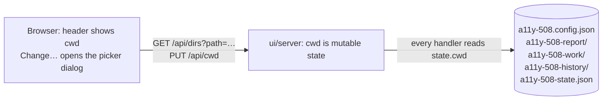

# A folder picker: choosing the repository from the dashboard

branch: folder-picker
slug: folder-picker

Written 2026-10-11, after [local-ui.md](local-ui.md) merged.

## Intent

The dashboard works on the directory it was started from. That is the right
default, and it is how the CLI works, but it means a developer who wants to
audit or fix a different repository has to stop the server, change directory
and start it again. This adds a folder picker to the dashboard: the current
working directory is shown in the header, and *Change…* opens a dialog in
which the developer browses the machine's folders, or pastes a path, or picks
a recent one, and switches the dashboard to it while no run is active.
Everything that is relative to the working directory, the config, the
report, the history, the ledger, the session file, the loop's commits,
follows the switch. A `--dir <path>` launch flag does the same from the
command line.

A browser cannot hand a page a filesystem path, so the picker is not the
operating system's folder dialog. The local server lists directories for the
page, which is fine because the server is local, bound to `127.0.0.1`, and
gated by the per-launch session secret.

## The shape

### The server

`createDashboard` keeps `cwd` in a closure today (`ui/server/app.mjs:45`),
and every handler reads that constant. It becomes `state.cwd`, read at the
time of each request, and set in exactly two places: at launch (`--dir`,
else `process.cwd()`) and by `PUT /api/cwd`.

- `--dir <path>` on `main.mjs`: resolved against the launch directory; the
  server refuses to start, with the reason, when it is not a readable
  directory.
- `GET /api/dirs?path=<absolute path>`: the directory's subdirectories, sorted
  by name, each with `name`, `path`, and `hidden` (a leading dot, or the
  hidden attribute on Windows); never files. The response also carries the
  resolved `path` (symlinks followed), its `parent` (null at a root), and the
  `facts` for that directory: `git` (is a repository), `config`, `report`,
  `ledger`, `session` (each a boolean), so the picker can show at a glance
  what a folder holds. With no `path`, the roots: `/` on macOS and Linux,
  and the drive letters that exist on Windows (`C:\`, `D:\`, …, probed, no
  `wmic`). `GET /api/dirs?path=~` and a path starting with `~/` resolve to
  the home directory. A path that does not exist, is not a directory, or
  cannot be read returns 404 or 403 with the operating system's message,
  never a stack trace, and never crashes the server.
- `PUT /api/cwd`, body `{ path }`: 409 while any run is active (crawl,
  troubleshoot, login, loop, dry-run, install). Otherwise it resolves the
  path as above, requires a readable directory, sets `state.cwd`, forgets a
  finished run (so `GET /api/runs/current` is `null` and the Live-run screen
  does not show another directory's run), invalidates cached detection
  results that depend on the directory (none today; say so in a comment),
  and returns what `GET /api/env` would. Errors come back as 400/403/404
  with the message, and `state.cwd` is unchanged.
- `GET /api/env` already returns `cwd`; it gains `cwdFacts` with the same
  five booleans, and `launchDir` (where the server was started), so the
  picker can offer *Back to where I started*.
- Nothing else in the server changes shape: reports, history, ledger, config,
  session, the command line shown, and the child's `cwd` all read
  `state.cwd` at request time.

### The screens

- **Header, every screen.** The working directory, shortened from the left
  with the full path in a tooltip and in the accessible name, and a
  **Change…** button. The button is disabled while a run is active, with
  the reason in its tooltip and accessible description.
- **The picker dialog.** A native `<dialog>`, opened modal, labelled *Choose
  a working directory*, focus moved in on open and back to Change… on close,
  closed by Escape, Cancel, or Choose.
  - A *Path* text field holding the directory being browsed; typing an
    absolute path (or `~`, or `~/…`) and pressing Enter or **Go** browses
    there; an error from the server is shown inline next to the field and
    nothing changes.
  - Breadcrumbs for the current path, each one a button that browses to that
    ancestor; at the top, the roots (drives on Windows).
  - The subdirectory list: a listbox of folders, each with its name and the
    facts as short badges (*git*, *config*, *report*, *ledger*, *session*),
    activated by double-click, Enter, or an *Open* button, with the
    keyboard arrows moving between items. A *Show hidden folders* checkbox,
    off by default, remembered in the browser.
  - **Recent**: the last eight directories chosen, most recent first, kept
    in the browser's `localStorage` (a per-viewer convenience, not shared
    state), each a button that browses there; one that no longer exists is
    shown with *missing* and browsing it shows the server's error.
  - *Back to where I started* when the current directory is not the launch
    directory.
  - **Choose this folder** switches to the directory being browsed. On
    success the dialog closes, the header updates, the recents gain the
    entry, and every screen re-reads its data (`/api/env`, the report, the
    ledger, the config form, the history). The Run form's URL and options
    are kept; its auth mode switches to *use saved session* when the new
    directory has one and the old one did not, as it does on first load.
  - When the chosen directory is not a git repository the dialog still
    closes, and the Fix-loop screen shows its existing *not a git repository*
    notice; a crawl needs no repository.
- **Fix loop screen.** Its config form, ledger board, and round chart show
  the new directory's data after a switch, and a form that was being edited
  is discarded with no prompt (the server never saw it).

### Tests

- **Server** (`ui/server/test/`, `node:test`, no install): `/api/dirs` on a
  temporary tree with files, hidden directories, a symlink to a directory,
  and an unreadable directory (mode 000 on POSIX; on Windows the unreadable
  case is a path on a drive that does not exist, which the test says); the
  roots on each platform; `PUT /api/cwd` happy path, 409 during a run, 404
  and 400 cases, that `GET /api/env`, `/api/reports`, `/api/ledger`,
  `/api/config` and a spawned run all follow the switch; `--dir`.
- **Playwright** (`ui/e2e/folder-picker.spec.ts` plus small additions to
  existing specs): one test per acceptance criterion, through the dialog,
  with the fixture site from `test/fixture-site.mjs` as the crawl target and
  two temporary working directories prepared with different contents.
- **The self-audit** (`self-audit.spec.ts`, AC 20 of the previous plan)
  keeps crawling every route; the picker is a disclosure the crawler opens
  on each screen, so the dialog is audited by the existing test, including
  the 4.G/4.H focus checks and the 5.C unnamed-dialog check.
- Windows CI already runs both suites; the drive-letter root and the hidden
  attribute are asserted there.

## What must not move

- The CLI: no change under `bin/` or `src/`; `test/human-golden.mjs` stays
  green; the core keeps zero dependencies.
- The server stays dependency-free and Node 18 compatible.
- Every existing server test and Playwright test stays as it is; the
  existing specs gain assertions only where this plan says.
- The session secret and `Host` checks apply to the two new endpoints
  exactly as to the others. The directory listing is directories only.
- Launching with no flag still means `process.cwd()`.

## Acceptance criteria

1. The header on every screen shows the working directory, and
   **Change…** opens a modal dialog named *Choose a working directory* with
   focus inside it; Escape closes it and returns focus to Change….
2. The dialog lists the subdirectories of the current working directory, in
   name order, with no files; a hidden directory appears only when *Show
   hidden folders* is on; each row shows the facts for that folder (a row
   whose folder holds a report shows the *report* badge; one that is a git
   repository shows *git*).
3. Opening a row browses into it and the breadcrumbs grow by one; activating
   a breadcrumb browses back; at the roots the listing shows `/` on POSIX
   and the existing drive letters on Windows.
4. Typing an absolute path and pressing Enter browses there; `~` browses to
   the home directory; a path that does not exist, or names a file, shows
   the server's message inline, the listing is unchanged, and the working
   directory is unchanged.
5. **Choose this folder** switches: `GET /api/env` returns the new `cwd`,
   the header shows it, the Report screen shows the new directory's latest
   report (and *no report yet* when it has none), the Fix-loop form shows
   the new directory's config, and the ledger board its ledger.
6. After a switch, a crawl started from the Run screen writes
   `a11y-508-report/report.json` in the new directory and nothing in the
   old; the command shown on the Run screen names the new directory; a dry
   run reads the new directory's config and writes its ledger there.
7. While a run is active, Change… is disabled with a reason, and
   `PUT /api/cwd` returns 409 without changing the directory; after the run
   ends it is enabled again.
8. After a switch, `GET /api/runs/current` is `null`, and the Live-run
   screen says there is no run in this directory rather than showing the
   previous directory's finished run.
9. Recent directories: after choosing two directories and reloading the
   page, the dialog lists both under *Recent*, most recent first, each
   browsable with one activation; a recent whose directory was deleted is
   marked *missing* and browsing it shows the server's error.
10. `node ui/server/main.mjs --dir <path>` starts in that directory
    (relative paths resolved against the launch directory); `--dir` naming
    a file or a missing path exits non-zero with the reason and no server
    listening; the dialog's *Back to where I started* returns to the launch
    directory after a switch.
11. `GET /api/dirs` and `PUT /api/cwd` return 401 without the session secret
    and 403 with a foreign `Host`; `GET /api/dirs` on an unreadable
    directory returns 403 with a message, and the server keeps serving.
12. The self-audit (previous plan's AC 20) is green with the picker on every
    screen, and its report shows the dialog's controls were exercised (a
    4.G/4.H check ran on the Change… disclosure, or its findings list the
    dialog's selector).
13. Everything that passed before still passes: both existing suites and the
    core suite, on macOS, Linux CI and Windows CI, with no existing
    assertion changed.

## How this fails silently, and what is written to catch it

1. **Files in the listing.** *Mutation*: the server lists every directory
   entry. AC 2's test, which plants a file beside the folders, turns red.
2. **The child still runs in the old directory.** The closure `cwd` is left
   in one spawn. *Mutation*: pass the launch directory as the child's `cwd`.
   AC 6's test, which looks for `report.json` in both directories, turns
   red.
3. **A report endpoint still reads the old directory.** *Mutation*:
   `listReports` uses the launch directory. AC 5's test turns red on the
   Report screen's content.
4. **A switch during a run.** *Mutation*: remove the active-run check. AC 7's
   test turns red on the 409 assertion.
5. **The server trusts the client's path.** *Mutation*: `PUT /api/cwd` sets
   `state.cwd` before checking the directory exists. AC 4's test turns red.
6. **The finished run follows the switch.** *Mutation*: do not clear the
   finished run. AC 8's test turns red.
7. **Recents are not persisted.** *Mutation*: keep recents in a component
   field only. AC 9's test, which reloads the page, turns red.
8. **`--dir` is parsed and ignored.** *Mutation*: parse the flag, start in
   `process.cwd()`. AC 10's test turns red.
9. **The new endpoints skip the auth checks.** *Mutation*: route
   `/api/dirs` before the secret check. AC 11's test turns red.
10. **The dialog has no name, or traps focus wrongly.** *Mutation*: remove
    `aria-labelledby` from the dialog. AC 12's self-audit turns red on 5.C
    (unnamed dialog); AC 1's focus assertions catch a dialog that opens
    without moving focus.
11. **Hidden folders leak or vanish.** *Mutation*: ignore the `hidden`
    flag. AC 2's test turns red in one direction or the other.
12. **An unreadable directory crashes the server.** *Mutation*: let
    `readdirSync` throw out of the handler. AC 11's test, which makes a
    request after the 403, turns red.

## Order of work

1. Server: `state.cwd`, `--dir`, `GET /api/dirs`, `PUT /api/cwd`, `cwdFacts`,
   and the server tests, security first (AC 10, 11, then 5–8 at the API
   level).
2. App: header control, the dialog, browsing, recents, the switch and the
   re-reads (AC 1–5, 9, 10).
3. The run-related criteria through the browser (AC 6–8).
4. Self-audit (AC 12), rebuild `ui/dist`, the full suites (AC 13), README.

## Non-goals

- The operating system's native folder dialog: a web page cannot receive a
  path from it.
- Creating, renaming or deleting folders, cloning a repository, or
  initialising git from the dashboard.
- Several working directories open at once, or per-tab directories; the
  server has one.
- Remembering recents on the server or across machines; they live in the
  viewer's browser.
- Browsing files, previewing contents, or any listing beyond directory
  names and the five facts.
