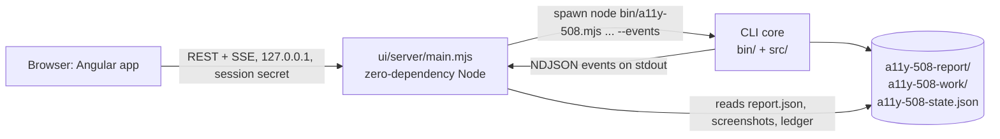

# A local dashboard for running a11y-508

branch: local-ui
slug: local-ui

Written 2026-10-11.

## Intent

Running the crawler today means composing a long command line, exporting a
token by hand, reading a scrolling log in which the result is a few lines at
the bottom, and then opening `report.html` separately. The fix loop is
harder: a config file written by hand, a terminal prompt to press Enter after
a deploy, and `a11y-508 status` to see where things stand.

This adds a local web dashboard, an Angular app with ngx-charts. A developer
starts it with one command in the repository that vendors the tool, and does
everything there: sign in, start a crawl, troubleshoot, read the report, and
run the fix loop. The CLI stays as it is and does the work underneath. The
dashboard drives it as a child process and reads a machine-readable event
stream from it instead of its human-readable output. A person sees progress,
problems, and results as structured screens. The raw output is still there
behind a disclosure for anyone who wants it.

It runs only on the developer's machine, for that developer. It is not a
hosted service.

## The shape



Three parts, in three places:

1. **The core gets one flag, `--events`** (`src/`). With it, every line the
   CLI would print becomes one JSON object per line on stdout instead. The
   types are `start`, `info`, `warn`, `error`, `page`, `coverage`,
   `summary`, `troubleshoot`, `login-waiting`, `session-saved`, `round`,
   `step`, `task`, `ledger`, `await-deploy`, and `done`. Each has a fixed
   shape, documented in the README. `page` carries the audited and
   discovered counts so a progress bar can be drawn from it alone; `done`
   carries the exit code. `--events` takes precedence over `--json` and
   `--quiet`. Without the flag, the output is unchanged byte for byte.

   The loop runs each round's crawl as a child process with `--json --quiet`
   and keeps its stdout to itself (`crawlOnce` in `src/loop.mjs`). With
   `--events`, the loop passes `--events` to that child and relays its
   `page`, `coverage` and `summary` events to its own stdout, each tagged
   with the round, so a loop round shows the same per-page progress as a
   plain crawl. Without `--events`, `crawlOnce` behaves as it does today.

   The core keeps zero dependencies. These are the only changes to the core.
2. **A local server, `ui/server/`**: plain `node:http`, zero dependencies,
   Node 18+, the same rules as the core. It serves the built app, holds the
   token in memory, spawns one CLI run at a time with `TOKEN` in the child's
   environment, relays its events over Server-Sent Events, and reads
   `report.json`, screenshots, the ledger, and the config from the working
   directory it was launched in.
3. **The Angular app, `ui/app/`**: standalone components and signals,
   ngx-charts, and plain CSS. No component library unless the builder finds
   that one is needed for accessibility, in which case they declare it. The
   Angular version is the newest that ngx-charts supports on the day of the
   build; the builder records both versions in the PR body. Two rules apply
   to every chart on every screen: it has a data-table toggle showing the
   same numbers, because an SVG chart is not accessible on its own and this
   is an accessibility tool; and its animations are off when the viewer has
   asked for reduced motion. Every progress bar is a native `<progress>`
   element with a visible label, so its value is read out as well as seen.
   The screens are routes, and the navigation between them is real links
   with `href`, so the crawler itself can find them.

### Running it needs no install

The README promises that nothing has to be downloaded to run the tool, and the
dashboard keeps that promise. The **built** app is committed under
`ui/dist/`, and the server has no dependencies. `node ui/server/main.mjs` (or
`npm run ui` at the root, which adds a script and no dependency) works from a
clean clone with nothing else installed. Only someone **changing** the UI
needs `npm ci` in `ui/` and a Node version that Angular supports (22 LTS). A
fresh `ui/dist/build-info.json` records a hash of `ui/app/` plus
`ui/package-lock.json`. The server warns at startup when the hash does not
match the source, and CI fails on a mismatch.

In a consuming repository, the README adds one script alongside the
existing one:

```json
"e2e:a11y-508:ui": "node tools/a11y-508/ui/server/main.mjs"
```

### The server

- Binds to `127.0.0.1` only, on `--port` (default 5508; the next free port if
  that one is taken), and opens the default browser unless `--no-open` is
  passed.
- **Session secret**: a random value generated at each launch is put in the
  URL fragment that the server opens. The app moves it into
  `sessionStorage`, removes it from the address bar, and sends it as a header
  on every API call. Requests without it get 401. Requests whose `Host` is
  not `127.0.0.1:<port>` or `localhost:<port>` get 403, which blocks DNS
  rebinding.
- **The token**: it is entered in a password field, or taken from the
  server's own `TOKEN` environment variable if the developer launched it with
  one. It is held in server memory and passed only in the child's
  environment. It is never written to disk, never returned by any endpoint,
  never echoed into an event, and the server's relay redacts it from the
  child's output as a second line of defence. The app clears the field after
  submitting.
- **Endpoints**:
  - `GET /api/env`: working directory, tool version, whether a browser was
    found, whether a config file, a session file (and its age), and a
    previous report exist, and whether `TOKEN` is set in the server's
    environment (as a boolean only). It also reports which of the core's
    agent presets (`PRESETS` in `src/agent.mjs`: `claude`, `gemini`, `codex`)
    are installed, and the version each one prints for `--version`. Gemini
    CLI (`gemini`, from `@google/gemini-cli`) must be found as reliably as
    Claude Code and Codex, so detection does not rely on the server's own
    `PATH` alone. It also asks the developer's login shell
    (`$SHELL -lc 'command -v <name>'`; on Windows, `where`) and looks in
    `npm prefix -g`'s bin directory, because CLIs installed with `npm -g`
    or under nvm are often missing from the `PATH` of a process started
    another way. When a preset is found off `PATH`, the server runs it by
    that absolute path and shows that path on the picker. It also reports
    the developer's shell: `$SHELL` on macOS and Linux (zsh, bash, fish),
    PowerShell or `cmd` on Windows, found from `ComSpec` and `PSModulePath`.
  - `POST /api/agent/install`, body `{ agent }`, where `agent` is a preset
    name and nothing else; any other value is 400. The install command per
    preset is a fixed table in `src/agent.mjs` beside `PRESETS`
    (`npm install -g @anthropic-ai/claude-code`, `@google/gemini-cli`,
    `@openai/codex`), chosen per operating system where they differ. The
    command never comes from the request. It runs inside the developer's
    detected shell as a login shell (`$SHELL -lc '<command>'`; on Windows,
    the detected PowerShell or `cmd`), so the `npm` it finds is the one the
    developer uses, nvm included. It is a run like any other: it occupies
    the single run slot, streams its output over SSE, and ends with a `done`
    event carrying the exit code, after which the server re-detects the
    presets. `GET /api/env` also returns each preset's install command, so
    the picker can show it before anything is pressed.

    **When an install fails, the `done` event carries remedies, computed
    deterministically.** `installRemedies({ code, output, shell, platform,
    found })` in `src/agent.mjs` is a pure function over a fixed table.
    Each row has an id, a pattern matched against the exit code and the
    output, and a remedy: one or two sentences and, where one exists, the
    exact command to run, filled in for the detected shell and platform
    (the rc file is `~/.zshrc`, `~/.bashrc`, `~/.config/fish/config.fish`
    or `$PROFILE`). Rows are tried in order and every match is returned,
    most specific first. The table covers at least:

    | id | matches | remedy |
    |---|---|---|
    | `npm-missing` | `npm: command not found`, `'npm' is not recognized`, spawn `ENOENT` | Node.js is not on this shell's PATH; install Node 18+ or run `nvm use`, then retry |
    | `permission` | `EACCES`, `EPERM`, `permission denied` | npm's global folder is not writable; set a user prefix (`npm config set prefix ~/.npm-global` and the PATH line for the rc file), do not use `sudo` |
    | `network` | `ENOTFOUND`, `EAI_AGAIN`, `ETIMEDOUT`, `ECONNREFUSED`, `ECONNRESET`, `407` | the registry is unreachable; check VPN or proxy, set `npm config set proxy` / `https-proxy`, or point `npm config set registry` at the internal mirror |
    | `tls` | `SELF_SIGNED_CERT_IN_CHAIN`, `UNABLE_TO_GET_ISSUER_CERT`, `CERT_HAS_EXPIRED` | TLS inspection on the network; set `NODE_EXTRA_CA_CERTS` to the company CA bundle; never `strict-ssl false` |
    | `not-on-registry` | `E404`, `ETARGET` | the configured registry does not carry the package; `npm config get registry`, ask for it to be mirrored |
    | `node-too-old` | `EBADENGINE`, `Unsupported engine`, `requires Node` | this CLI needs a newer Node; `nvm install --lts` or install from nodejs.org |
    | `disk` | `ENOSPC` | the disk is full |
    | `execution-policy` | `running scripts is disabled`, `ExecutionPolicy` | PowerShell blocks npm's shim; `Set-ExecutionPolicy -Scope CurrentUser RemoteSigned` |
    | `not-on-path` | exit 0 but the preset is still not found | the install worked but npm's global bin directory is not on PATH; the line to add to the rc file, with `npm prefix -g` already expanded |
    | `unknown` | no other row matched | no known cause; the full output is shown with a suggestion to run the command in a terminal |

    The table is tested row by row in `test/remedies.mjs`, which runs under
    the root `npm test` with no install, so a row can never silently stop
    matching.
  - `POST /api/runs`, body `{ kind: crawl | troubleshoot | login | loop |
    dry-run, url, options, auth }`: returns 409 while another run is active,
    an install included.
    Before a crawl starts, a previous `a11y-508-report/` is moved to
    `a11y-508-history/<finishedAt>/`, so the latest report stays where the
    README's runbook says it is and the CLI's output directory is untouched.
    `a11y-508-history/` joins `.gitignore` and the README.
  - `GET /api/runs/current/events` (SSE): replays the run from its first
    event, then streams live events.
  - `POST /api/runs/current/stop`: sends SIGINT. A second call sends
    SIGTERM.
  - `POST /api/runs/current/continue`: writes a newline to the child's stdin.
    This is the loop's `deployed: "enter"` prompt.
  - `GET /api/reports`, `GET /api/reports/:id`, and
    `GET /api/reports/:id/screenshots/:file`: the latest report, each
    `a11y-508-history/<finishedAt>/`, and each `a11y-508-work/round-N/`.
    Every file path is confined to its report directory.
  - `POST /api/agent/test`, body `{ agent }`: runs the chosen agent once
    through the core's own `runAgent`, with a fixed prompt that asks it only
    to write a result file, and nothing it may edit. It reports whether a
    valid result came back, the time it took, and the agent's last lines of
    output. This is the cheapest way to show that the CLI is installed **and
    signed in** before a loop spends a round finding out. It runs only when
    the developer presses the button, because it costs one call to the
    assistant.
  - `GET /api/ledger`, and `GET`/`PUT /api/config`. PUT validates the config
    with the core's own `normalizeConfig` before it writes
    `a11y-508.config.json`.
  - `GET /api/command`: the command line equivalent to the current form, with
    the token shown as `$TOKEN`.

### The screens

1. **Run.** Fields: the start URL; authentication (a token field, *use TOKEN
   from my shell*, *use saved session* with its age, or cookies); the
   options people actually change (max pages, include and exclude patterns,
   fail-on); and an *Advanced* disclosure with every other flag `parseArgs`
   accepts. Below them: the equivalent CLI command with a copy button, so the
   same run can go into CI. A **Start** button and a **Sign in** button.
   When `/api/env` found no browser, a notice says so at the top, with the
   browser-path field brought out of *Advanced*, and Start stays disabled
   until a path is given.
2. **Live run.**
   - **A progress bar.** The crawl has no fixed total: pages are found as
     others are audited, up to `--max-pages`. So the bar is audited over
     discovered, labelled *12 of 40 pages found (limit 200)*, and its value
     moves on every `page` event. Before the first page it is indeterminate
     and reads *starting the browser*. At the end it reads the final counts
     and the result. In a loop round, the same bar shows the round's crawl,
     and during the fix step a second bar reads *fix 3 of 7*.
   - An ngx-charts area chart of violations accumulating as pages finish,
     stacked by impact.
   - A page list: one row per page with status, violation and review counts,
     and duration. It updates live.
   - Warnings and errors as separate notices at the top, not inline in a log.
   - Raw output behind a *Show raw output* disclosure.
   - A **Stop** button.
   - When the crawl cannot get in (any of the README runbook's "could not get
     in" outputs), the run ends with a notice and a **Troubleshoot with these
     settings** button.
3. **Troubleshoot.** The verdict, the navigation chain as a timeline of hops
   with status codes, whether the header went out, and the storage keys and
   cookies the app read. The runbook's `next` step is a button: *Retry with
   `--token-storage <key>`*, *Sign in*, or, for a network error, a plain
   statement with no button.
4. **Sign in.** Runs `--login-only`. The screen says that a Chrome window
   has opened and asks the developer to sign in there. It updates by itself
   when the session is saved, and the Run screen switches to *use saved
   session*.
5. **Report.**
   - The result in one line: PASS, FAIL, or *PASS on N pages, but coverage is
     incomplete*.
   - Coverage warnings directly under that line.
   - Totals by impact and the review count.
   - ngx-charts bar charts of violations by impact, by Trusted Tester test,
     and for the 15 worst pages. **Every chart has a data-table toggle**
     showing the same numbers, because SVG charts are not accessible on their
     own and this is an accessibility tool.
   - The findings table: filters by level, impact, test, page, and free text,
     and grouping by test or by page. Each row opens a detail panel with the
     message, the test condition and its WCAG criterion, the selector, the
     HTML, and the screenshot.
   - The manual checklist and the page table.
   - A link that opens the existing `report.html`.
6. **Fix loop.**
   - **The fixing assistant, chosen first.** A picker that always lists
     every preset in `src/agent.mjs` (Claude Code, Gemini CLI, Codex), in
     that order, plus *Custom command*. An installed preset shows its
     version, where it was found, and the exact command the loop runs. A
     preset that was not found is greyed out and marked *not installed*; it
     can still be selected, and selecting it shows the install command for
     this machine and an **Install** button. Pressing Install opens a
     confirmation that repeats the command and names the shell it will run
     in; nothing runs until the developer confirms. The install then runs
     as a run of kind `install`, its output streams onto the screen like a
     crawl's, and when it exits the server re-detects and the entry turns
     live. A failed install stays on the screen with the exit code, the
     remedies the server computed for it, each with its command and a copy
     button, and the output behind a disclosure; a **Retry** button runs
     the same install again after the developer has acted on a remedy.
     *Custom command* takes a command line and checks that it contains
     `{promptFile}`. A **Test assistant** button calls `/api/agent/test`
     and shows *ready*, *not signed in or failed* (with the agent's own
     output), or *timed out*. The choice is saved as `agent` in the config.
     The screen states plainly that the assistant's changes are committed
     without review and that the `check` command is the only gate.
   - A config form that reads and writes `a11y-508.config.json`, with every
     other key from the README's table, validated by the server.
   - **Dry run**, **Start**, and **Stop** buttons. Dry run needs no
     assistant. Start stays disabled until an assistant is chosen and its
     command is found, and until `check` is set or the developer has
     confirmed running without a gate. A failed or never-run test does not
     block Start; it shows as a warning next to it.
   - The current round and step: crawl, triage, fix *n* of *m*, gate, commit,
     or waiting for deploy.
   - A **Deployed — continue** button whenever the loop waits for Enter.
   - A ledger board: counts for each status, and the open, pending,
     awaiting-triage and needs-a-person lists, with what
     `a11y-508 status` shows for each.
   - An ngx-charts line chart of open and verified findings by round.
7. **History.** Previous reports and loop rounds, newest first. Opening one
   shows it on the Report screen.

### Tests

- **The core**: `test/run.mjs` gains an `--events` run against the fixture
  site. It asserts the schema of every event, that the `page` events agree
  with `report.json`, and that the default human output is unchanged.
  `test/loop.mjs` gains the same checks for the loop events, including
  `await-deploy`.
- **The server**: its own tests under `ui/server/test/`, written with
  `node:test` and `node:assert` so they need no install, and added to the
  root `npm test` script. They drive the real server over HTTP: the
  security criteria, the run slot, the history move, preset detection with
  a controlled `PATH`, and the install endpoint with a stub `npm`.
- **The UI**: Playwright under `ui/e2e/`. The harness starts the existing
  fixture site, which requires a token on every request, and starts the real
  server in a temporary working directory. Each test drives the real CLI
  through the browser. Loop tests use `test/fake-agent.mjs` in a temporary
  git repository, as `test/loop.mjs` already does. To share the fixture
  server, move it out of `test/run.mjs` into `test/fixture-site.mjs`. The
  move must not change what `test/run.mjs` asserts.
  - **Sign in needs a site that signs in by itself.** `interactiveLogin`
    finishes when the headed browser has settled on the start origin for
    six seconds, and nothing in the harness can click inside the CLI's own
    Chrome window. So `test/fixture-site.mjs` gets an `autoLogin` mode: its
    `/login.html` waits a second, sets the session cookie and the storage
    keys `app.html` expects, and returns to `/`, and in that mode the server
    accepts the cookie in place of the bearer header. AC 9's test runs
    `--login-only` against that mode and waits for `session-saved`.
  - **The self-audit uses the tool's own auth features.** The harness runs a
    fixture crawl and a dry-run loop first, so every screen has content,
    then runs a11y-508 against the dashboard with `TOKEN` set to the session
    secret, `--token-header` set to the secret's header name,
    `--token-storage` set to the key the app reads it from, and
    `--no-follow-clicks`, so the crawler reaches every screen through the
    nav links and presses no Start or Stop button.
- **CI**: a job that runs `npm --prefix ui ci`, typecheck, unit tests,
  `ui/dist` freshness, and the Playwright suite on Node 22 with Chrome. The
  existing Node 18/20/22 core matrix stays as it is; the root `npm test` now
  runs the server's tests on it too, because the server must work on Node
  18.

## What must not move

- The core's zero dependencies: the root `package.json` gains a `ui` script,
  its `test` script grows by the server and remedies tests, nothing is added
  under `dependencies`, and `files` stays the same.
- The CLI's flags, exit codes, human-readable output, and the `report.json`
  shape. The README runbook for AI assistants stays correct, word for word.
- `npm test` at the root: it still needs no install, and every existing
  assertion stays in place.
- The loop's behaviour: its commits, gate, ledger, and resume work the same
  whether the CLI or the dashboard starts it.

## Acceptance criteria

1. From a clean clone with no `npm install` anywhere, `npm run ui` starts the
   server on `127.0.0.1` and opens the dashboard, using Node 18 or newer.
2. With the fixture URL and its token entered, **Start** shows each page as
   it is audited. The progress bar's value and label read *N of M pages
   found* and change with every page; the page list and each page's counts
   match that run's `report.json` when it finishes, and the bar then reads
   the final counts. The live chart's data table equals the page list's
   running totals.
3. During and after a run, warnings and errors appear as separate notices.
   Raw output is not on screen until *Show raw output* is opened.
4. When a run finishes, the Report screen shows the result line, the totals
   by impact, and the review count, all equal to `report.json`'s `summary`.
   Each chart's data table shows the same numbers as that chart.
5. The findings can be filtered by level, impact, test, page, and text, and
   the detail panel shows the finding's selector, HTML, WCAG criterion, and
   screenshot.
6. A run with coverage warnings reads *PASS on N pages, but coverage is
   incomplete* and lists the warnings. It never reads a plain PASS.
7. **Stop** ends a crawl within 10 seconds, the run's Chrome process is gone,
   and the screen says *Stopped*.
8. A run that cannot get in (the fixture site with a wrong token) ends with
   the *Troubleshoot with these settings* button. The Troubleshoot screen
   shows the navigation chain and the next step, and a next-step button
   reruns with the flag it names.
9. **Sign in** runs the CLI's `--login-only` flow against the fixture's
   `autoLogin` mode and shows the waiting state. When the session file is
   written, the screen says so, the Run screen switches to *use saved
   session*, and the next crawl runs with `--state` and audits `app.html`.
10. The command shown on the Run screen, run in a terminal with `TOKEN` set,
    produces a `report.json` whose `summary` matches the dashboard run's
    `summary`. The comparison leaves out timings.
11. The loop config form writes an `a11y-508.config.json` that `a11y-508
    loop` accepts, and the form rejects a config that the core rejects,
    showing the core's message.
12. The fixing-assistant picker always lists Claude Code, Gemini CLI and
    Codex. With the harness controlling `PATH` and supplying stub
    executables, each entry is live or greyed exactly as the stub is present
    or absent, a live entry shows its command and where it was found, and
    the choice is saved as `agent`. Gemini CLI is detected both when
    `gemini` is on `PATH` and when it is only in `npm prefix -g`'s bin
    directory, and the loop then runs it by the path that was found.
    **Test assistant**, using `test/fake-agent.mjs` as a custom command,
    shows *ready*. With an agent that writes no result, it shows *failed*
    and the agent's output. Start is disabled while no installed assistant
    is chosen.
13. Selecting a greyed entry shows that preset's install command and the
    name of the detected shell. Nothing runs until **Install** is pressed
    and the confirmation, which repeats the command, is accepted. With a
    stub `npm` on `PATH` that records its arguments and creates the
    executable, the install's output streams onto the screen, the entry
    turns live when it exits, and the recorded arguments are the preset's
    install command. A stub `npm` that exits 1 printing `EACCES` leaves
    the entry greyed, shows the exit code, and shows the `permission`
    remedy with its command filled in for the harness's shell; a stub that
    exits 0 without creating the executable shows the `not-on-path` remedy
    with the real `npm prefix -g` path in it. **Retry** runs the install
    again. `POST /api/agent/install` with anything but a preset name
    returns 400 and runs nothing.
14. **Dry run** fills the ledger board. **Start**, with the fake agent, runs
    a round that commits a fix. During the round's crawl the progress bar
    and page list move page by page, as they do for a plain crawl, and
    during the fixes a bar reads *fix n of m*. With `deployed: "enter"`, the
    loop shows **Deployed — continue**, and pressing it starts the next
    round. The board's counts equal `a11y-508 status`, and the round chart's
    data table equals the ledger's rounds.
15. After two crawls, History lists both, the earlier one from
    `a11y-508-history/`, with the loop's rounds beside them, and opening any
    one shows it on the Report screen. `a11y-508-report/` holds only the
    latest.
16. The token appears in no file under the working directory or the system
    temp directory, in no API response, in no event, and in no part of the
    page after submission.
17. The API returns 401 without the session secret and 403 for a foreign
    `Host` header. A screenshot path that escapes its report directory
    returns 404.
18. While a run is active, **Start** is disabled and `POST /api/runs` returns
    409.
19. Without `--events`, the CLI's output for the fixture site is identical to
    `origin/main`'s, ignoring timings. `npm test` passes, and the core has no
    dependencies.
20. a11y-508, run against the dashboard itself as described under Tests,
    audits every screen (the report's page list names each route) and
    reports no critical or serious violations.
21. When `ui/dist/build-info.json` does not match the source, the server
    prints a warning at startup, and the CI freshness check fails.

## How this fails silently, and what is written to catch it

1. **The live view drifts from the report.** If a `page` event is dropped,
   the dashboard undercounts, and nobody notices. *Mutation*: the server's
   relay drops every third `page` event. AC 2's test turns red when it
   compares the live list with `report.json`.
2. **The token leaks.** *Mutation*: `/api/env` returns the token, or the
   server writes the child's environment into a debug file. AC 16's test,
   which scans every captured response, every event, the DOM, and the files
   written during the run, turns red.
3. **Incomplete coverage reads as a pass.** *Mutation*: the Report screen
   ignores `summary.coverage.complete`. AC 6's test turns red.
4. **A chart shows the wrong numbers.** *Mutation*: swap `serious` and
   `critical` in the chart's data mapping. AC 4's test compares each chart's
   table with `report.json`, and turns red.
5. **Stop leaves Chrome running.** *Mutation*: the server kills only its own
   handle and does not signal the CLI's process. AC 7's test, which checks
   for the run's browser process afterwards, turns red.
6. **The event contract changes and the UI quietly ignores it.**
   *Mutation*: the core renames `page` to `page-done`. The core schema test
   (AC 19) and AC 2's test both turn red. The app also shows an *unknown
   event* notice instead of dropping what it does not recognise.
7. **The default CLI output changes.** *Mutation*: alter one line of the
   human logger. AC 19's comparison with `origin/main` turns red.
8. **The API is open to anything on the machine.** *Mutation*: remove the
   session-secret check. AC 17's test turns red.
9. **Path traversal through screenshots.** *Mutation*: remove the path
   confinement. AC 17's request for `../../package.json` turns red.
10. **The wrong assistant runs, or none can.** The picker offers a preset
    that is not installed, and the loop fails on its first fix. Or the
    saved `agent` is not the one the developer chose. *Mutation*: `/api/env`
    reports every preset as found, or the form saves the first preset
    regardless of the selection. AC 12's test turns red.
11. **The loop waits for Enter with no button.** *Mutation*: the core stops
    emitting `await-deploy`. AC 14's test times out on the missing button,
    red on that assertion.
12. **Exit code 1 is shown as an error.** Violations found is a finding, not
    a tool failure. *Mutation*: the server maps exit code 1 to `error`. AC
    4's test, which expects the FAIL result line and no error notice on the
    fixture site, turns red.
13. **The dashboard itself becomes inaccessible.** *Mutation*: remove the
    label from the URL field. AC 20's self-audit turns red on 5.A.
14. **A stale build is served.** *Mutation*: the freshness check always
    reports fresh. AC 21's test, which changes a file under `ui/app/` in a
    temporary copy, turns red.
15. **The progress bar never moves.** A bar bound to the wrong count sits at
    zero or at full and nobody notices a stalled crawl. *Mutation*: bind the
    bar's value to the discovered count instead of the audited count. AC
    2's test, which asserts the value changes with every page and ends at
    the final counts, turns red.
16. **A loop round shows no pages.** The loop's child crawl keeps its
    output, and the dashboard sits on *crawling* for minutes. *Mutation*:
    `crawlOnce` drops `--events` from the child's arguments. AC 14's test
    turns red on its per-page assertion.
17. **The install runs what the browser sent.** *Mutation*: the server
    accepts a `command` field from the body. AC 13's test, which posts one
    and expects 400, turns red.
18. **A failed install says only "failed".** *Mutation*: `installRemedies`
    returns the `unknown` row for everything. AC 13's `EACCES` test expects
    the `permission` remedy and turns red, and `test/remedies.mjs` turns
    red on every other row.
19. **History eats the latest report.** *Mutation*: the move to
    `a11y-508-history/` runs after the crawl instead of before. AC 15's
    test, which expects `a11y-508-report/` to hold the latest run, turns
    red.

## Order of work

1. `--events` in the core, for the crawl and the loop's relayed rounds, with
   its tests; the install and remedies tables in `src/agent.mjs` with
   `test/remedies.mjs`; and the README section on the event schema.
2. `test/fixture-site.mjs`, extracted from `test/run.mjs`, with the
   `autoLogin` mode.
3. The server, with its security tests (AC 16–18) written first, then
   preset detection, the install endpoint, and the history move.
4. The app shell, Run, and Live run (AC 1–3, 7, 18).
5. Report and History (AC 4–6, 15).
6. Troubleshoot and Sign in (AC 8–10).
7. Fix loop (AC 11–14).
8. The self-audit, `build-info.json`, the CI job, and the README (AC 20–21).

## Non-goals

- Replacing the CLI. It remains the interface for CI and for the AI-assistant
  runbook, and the dashboard is built on top of it.
- Any hosted, shared, or multi-user deployment, and any authentication
  beyond the per-launch local secret.
- Changing what the crawler checks, how it crawls, or what is in
  `report.json`.
- Editing ledger statuses from the dashboard, including marking a finding
  *won't fix*. The README tells people never to edit the ledger by hand, and
  making that a feature is a separate decision.
- Saving the manual checklist's progress anywhere other than the viewer's
  own browser.
- Packaging as a desktop app (Electron or similar).
- Windows-specific testing in CI. The server uses only cross-platform Node
  APIs and the CLI's existing signal handling, but CI covers Linux only, the
  same as the core.
