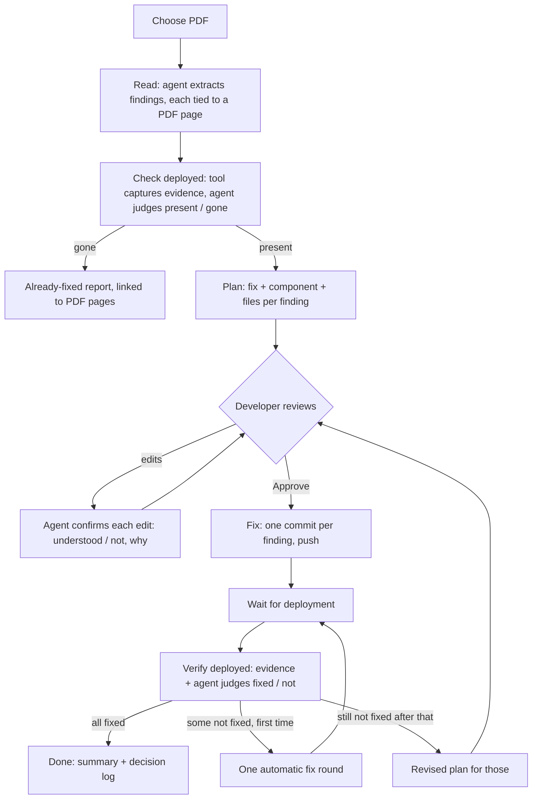

# Manual findings: fix what a tester found, from their PDF, under the developer's approval

slug: manual-findings
branch: manual-findings

## Intent

Joel, 2026-10-16: "Before starting use a file chooser to identify a PDF that identifies specific
things that need to be fixed that were found with manual testing. The AI would inspect [it] and
generate a plan that would specify what it will fix and what the fixes will be. The AI will be
prompted to simply make decisions rather than escalate, but the decisions it made should be
logged and available for review after the iteration is completed, the code is fixed, committed
and pushed." Then: "I would want to review the plan and be able to edit it ... if Gemini says it
will fix something in a specific component, I can override that component and Gemini would
confirm that it understood or not. This would be a flow that would only terminate once I
approved. Then it would launch the fix and then exit after confirmed in a deployed version that
it was fixed." Answers: the component is chosen with a **picker**; the **agent inspects the
deployed site** to confirm each fix; when a fix does not hold, **one automatic fix round, then a
revised plan** for approval. And: "the AI must first verify that the currently deployed version
has the identified issues and if they are no longer there then create a report with them clearly
identified and linked to the source PDF."

This is a second way in, beside the crawl loop, and the one deliberate exception to "never ask a
person to decide": the plan approval. Everything else stays turnkey — the agent decides, logs the
decision, and keeps going; each state says in one sentence what is happening and offers at most
one action besides Stop.

The flow, one run of kind `manual`:

The agent is the configured one (Advanced → assistant). **Gemini becomes the default** when
nothing is chosen and it is installed, for this flow and the crawl loop alike; Claude, Codex or a
custom command stay selectable.

## Acceptance criteria

1. **Choose the PDF.** The home screen gets **Fix from a test report (PDF)** next to Start. It
   opens a native file chooser (`<input type="file" accept="application/pdf">`); the file is
   uploaded to `POST /api/manual/pdf` (raw body, ≤ 50 MB, `%PDF-` magic checked, anything else
   refused with one plain sentence) and stored as `<work>/manual/<id>/source.pdf`, `<id>` a
   timestamp slug. The server serves it back at `GET /api/manual/<id>/source.pdf` so every later
   link can point at `…/source.pdf#page=N`. Starting it starts a run of kind `manual`
   (`startRun`, journaled like the others, survives a reload and is reattached like the others).

2. **Read: one finding per issue, each tied to the PDF.** The agent is given the PDF (copied into
   the tasks dir so every preset can read it) and the app's known routes (`/api/loop/routes`
   data, the start URL) and returns `findings[]`: `{ id, title, page (PDF page number), quote
   (the tester's words, verbatim, ≤ 300 chars), url or route, element (how the tester describes
   it), wcag?, expected }`. Where the PDF is vague (no route, two possible elements) the agent
   picks one and records the decision with its reason (criterion 9). Zero findings ends the run:
   "The PDF names no accessibility findings the assistant could read." with **Choose another
   PDF**. Stored in `<work>/manual/<id>/findings.json`.

3. **Check the deployed site first.** For each finding the tool (not the agent) opens the
   deployed page in its own browser with the saved sign-in (expired → the turnkey sign-in
   request, then it continues) and captures **evidence**: a screenshot, the accessibility tree,
   the outer HTML of the elements matching the finding's description (the agent supplies up to 5
   CSS selectors with the finding), and the Tab order (first 60 stops: role, name, selector).
   Files go to `<work>/manual/<id>/evidence/<finding>/before/`. The agent judges each finding
   from its evidence: `present`, `gone`, or `unreachable` (page did not load). It decides; there
   is no "unsure" — `unreachable` and doubtful cases are treated as `present` and the reason is
   logged.

4. **Already fixed in deployment: a report.** Findings judged `gone` go into
   `<work>/manual/<id>/already-fixed.md` and onto the screen as **Already fixed in the deployed
   site (N)**: each row shows the title, the tester's quote, a link **PDF page 4** to
   `source.pdf#page=4`, the deployed URL checked, the time checked, the agent's reason, and the
   screenshot. These never enter the plan. If every finding is gone the run ends there: "All 6
   findings in the PDF are already fixed in the deployed site." with the report open.

5. **The plan.** For the `present` findings the agent writes `plan.json`: per item `{ finding,
   fix (what it will change, in one or two sentences), component (name + file), files[],
   decisions[] }`. The **component picker** lists the repo's components: for Angular, every
   `@Component` class with its selector and file (`GET /api/manual/components`, scanned under the
   configured source folders); otherwise every source file (`.ts .tsx .js .jsx .vue .svelte
   .html`) under them. It is a searchable listbox (type to filter by name, selector or path);
   only listed entries can be chosen. Each plan item shows its finding (with the PDF page link
   and the before screenshot), the fix text (editable), the component (picker), the files (read
   only, derived), the agent's decisions, and **Remove from plan**.

6. **Edit, confirm, repeat — until Approve.** **Send changes** sends every edited item back to
   the agent with the developer's edit and the original. The agent answers per item:
   `understood: true` with a one-sentence restatement of what it will now do ("I will add an
   aria-label to the search button in SearchBarComponent, src/app/search/search-bar.component.ts,
   instead of HeaderComponent."), or `understood: false` with what it does not understand or
   why the edit cannot work as written (e.g. "SearchBarComponent does not render the Filters
   dialog the tester describes on PDF page 3."). It also updates `files[]` for the new component.
   The answer shows under the item. This repeats as often as the developer edits. **Approve
   plan** is enabled only when no item has an unsent edit or an answer `understood: false`; the
   step reads "Approve the plan to start fixing, or edit an item and send it to the assistant."
   Approval is the only way forward; the run waits for it without a time limit (and survives a
   dashboard restart in this state). Every version of the plan is kept (`plan-v1.json`, …).

7. **Fix, commit, push.** After approval each item is fixed by the agent with a prompt built from
   the approved item — the fix text and component are binding, the files are the starting
   scope, the finding's evidence is attached — through the loop's existing machinery: source
   folders only (changes elsewhere reverted), the build gate, one commit per item
   (`a11y-508: manual <PDF p.4> <title>`), tests once with bisect, the build marker, push to the
   work branch. An item the agent reports it could not fix is recorded as a decision and goes to
   verification anyway (it will show not fixed).

8. **Confirm in the deployed version; one more round; then a revised plan.** After the push the
   run waits for the deployment exactly as the loop does (`deployed` setting, bundle change, no
   limit from the dashboard), then captures evidence again (`…/after-1/`) and the agent judges
   each item `fixed` or `not-fixed` with its reason. Not fixed → **one automatic round**: those
   items are fixed again with the judgement and the after-evidence as the prior attempt, pushed,
   waited for, verified (`after-2/`). Still not fixed → the agent writes a **revised plan** for
   just those items (new fix text / component, its reasons) and the flow returns to criterion 6
   with "2 fixes did not hold in the deployed site after two tries. Review the revised plan."
   After that approval the same fix → verify → one retry → revised plan cycle repeats. The run
   ends only when every approved item is `fixed` in the deployed site: "Done: 4 findings from
   the PDF are fixed and confirmed in the deployed site; 2 were already fixed." with **Show
   decisions**.

9. **The decision log.** Every decision is appended to `<work>/manual/<id>/decisions.ndjson`:
   `{ at, stage (read|check|plan|confirm|fix|verify|replan), finding, by (agent|developer),
   decision, reason, evidence? }` — the agent's interpretations of the PDF, each present/gone
   judgement, each plan choice (component, files, approach), each confirmation, every developer
   edit and removal (before → after), approval (with the plan version), each commit, each
   fixed/not-fixed verdict. When the run ends the tool writes `decisions.md`: grouped by finding,
   each finding headed by its title and a link to its PDF page, then its decisions in order, the
   commits (links via `commitLink`), and before/after screenshots. The home screen's **Show
   decisions** opens it (also for past manual runs, from History); while a run is going the
   log is a collapsed section on the manual step. Every agent prompt in this flow tells it to
   decide rather than ask and to state each decision with a reason in its result.

10. **Gemini is the default assistant.** `PREFERENCE` in `ui/app/core/driver.ts` becomes
    `['gemini', 'claude', 'codex']`; an explicit choice in Advanced or the config wins as today.
    The CLI keeps requiring `agent` (no change).

11. **A CLI entry for tests and scripts.** `a11y-508 manual <pdf> [--config] [--agent] [--events]`
    runs the same flow; the plan review is driven over the run's control channel (the server
    writes the edited plan to `plan-edit.json` and sends `review` / `approve` on stdin, like
    `dashboardWords`). Without `--events` it prints the plan path and waits for
    `approve` on stdin.

## How this fails silently

1. **(a) A non-PDF is accepted.** Mutation: drop the `%PDF-` check. Red: uploading a `.txt`
   renamed `.pdf` starts a run; expected: refused, no run, the sentence shown.
2. **(b) A finding loses its PDF page.** Mutation: the reader drops `page`. Red: the
   already-fixed row and the plan item have no `PDF page N` link to `source.pdf#page=N`.
3. **(c) The deployed check is skipped.** Mutation: mark every finding `present` without
   capturing. Red: a fixture finding that the fixture site no longer has appears in the plan
   instead of in Already fixed, and `evidence/<f>/before/` is empty.
4. **(d) Already fixed items reach the fix.** Mutation: plan from all findings. Red: a `gone`
   finding gets a commit.
5. **(e) An override is not honoured.** Mutation: the fix prompt uses the agent's original
   component. Red: after picking another component and approving, the commit touches the
   original component's file, not the chosen one.
6. **(f) Approve while misunderstood.** Mutation: Approve ignores `understood: false`. Red: with
   the fake agent answering `understood: false`, **Approve plan** is enabled.
7. **(g) The flow ends without approval.** Mutation: auto-approve after the first plan. Red: a
   commit appears before Approve is pressed; the run must sit in review indefinitely (checked
   for 5 s and across a dashboard restart).
8. **(h) The picker accepts anything.** Mutation: free text allowed. Red: typing a name that is
   not a listed component can be chosen.
9. **(i) Verification trusts the commit.** Mutation: mark items fixed after push. Red: with the
   fake deploy serving the old page, items show fixed; expected: not-fixed, one more round.
10. **(j) More or fewer than one automatic retry.** Mutation: retry twice / zero times. Red:
    with a fix that never holds, there must be exactly two fix commits for it before the revised
    plan appears, and no third without a new approval.
11. **(k) A decision goes unlogged.** Mutation: skip logging developer edits. Red: after an edit
    and approval, `decisions.md` has no entry with `by: developer` showing before → after.
12. **(l) Default is not Gemini.** Mutation: restore the old `PREFERENCE`. Red: with both Claude
    and Gemini on PATH and nothing chosen, `Driver.agent` is `gemini` (vitest).

## Non-goals

- No PDF parsing library and no OCR in the tool: the agent reads the PDF. A preset that cannot
  read PDFs fails the read stage with that sentence; no fallback.
- No .pptx/.docx input (the PDF only).
- The agent does not get a browser or web access; the tool captures evidence and hands it over.
  `FOCUS` stays.
- The manual flow does not crawl the site or touch the ledger's crawl findings; the crawl loop is
  unchanged except for the default assistant.
- `decisions.md` and the evidence stay in the tool's work folder; nothing is committed to the
  app's repository besides the fixes and the build marker.
- No multi-user review, comments or sharing of the plan.

## Where things live (for the builder)

Agent: `src/agent.mjs` (`PRESETS` 15-19, `runAgent` 244, prompt helpers `fixPrompt` 349 /
`triagePrompt` 405 / `block` 341, `FOCUS` 345) — add `manualReadPrompt`, `manualCheckPrompt`,
`manualPlanPrompt`, `manualConfirmPrompt`, `manualVerifyPrompt`, `manualReplanPrompt`.
Loop pieces to reuse, not copy: `callAgent` 405, source-folder revert ~1185, build gate ~1206,
commit ~1230, tests + bisect ~1255, marker ~1426, push ~1449, `waitForDeploy` 701, sign-in
(`src/login.mjs`). New core in `src/manual.mjs`; evidence capture in `src/evidence.mjs` on the
crawler's CDP browser. Server: `ui/server/app.mjs` `startRun` 530-614, `loopArgs`
(`args.mjs` 98), run journal (`run-journal.mjs` 262), control words (`dashboardWords`
loop.mjs 355), SSE 885. UI: `ui/app/screens/home.ts` (Start area, fixes dialog 53-80 for the
row style), `core/driver.ts` (`PREFERENCE` 10, `agent` 42), `core/git-links.ts`, History for past
runs. Tests: `ui/e2e/harness.ts`, a new `ui/e2e/manual.spec.ts`, `test/fake-agent.mjs` gains
`kind`s `manual-read|manual-check|manual-plan|manual-confirm|manual-verify|manual-replan`
(scripted by env: which findings are gone, `understood: false` once, a fix that never holds), a
hand-written tiny `test/fixtures/manual-findings.pdf` (2 pages), fixture pages under
`test/fixtures` with the manual issues, `test/event-schema.mjs` for the new events. Local gate:
`npm --prefix ui run typecheck && npm --prefix ui test && npm test && npm --prefix ui run e2e`,
`npm --prefix ui run build` (Node 22) before specs, `freshness`.
